# Wan2GP Desktop Launcher — Tauri Edition

> The easiest way to run **Wan2GP (WanGP)** — the open-source generative video/image/audio toolkit — on Windows. One installer. One click to launch. Zero Python/CUDA setup. Now with a **Rust + Tauri** shell: a fraction of the download, a fraction of the RAM.

[](https://github.com/GKartist75/Wan2GP-Desktop-Tauri/stargazers) &nbsp; [](https://github.com/GKartist75/Wan2GP-Desktop-Tauri/releases) &nbsp; [](https://github.com/GKartist75/Wan2GP-Desktop-Tauri/releases) &nbsp; [](https://tauri.app/) &nbsp; [](https://www.rust-lang.org/)

<p align="center">
  <a href="https://github.com/GKartist75/Wan2GP-Desktop-Tauri/releases/latest" style="display:inline-block;padding:14px 36px;background:#2ea043;color:#fff;border-radius:8px;font-size:1.1rem;font-weight:600;text-decoration:none">
    ⬇ Download for Windows — Latest Release
  </a><br>
  <code>Wan2GP.Desktop.Launcher.Tauri_*_x64-setup.exe</code> · ≈ 3 MB · Windows 10 / 11<br>
  <small>Hardware needs scale with the model you pick — start at 6 GB VRAM, up to 24 GB+ for max quality.</small><br>
  <small>⚠️ Unsigned installer — "unknown publisher" warning is normal for open-source without a code-signing cert.</small>
</p>

> **New here? What is Wan2GP?** [WanGP](https://github.com/deepbeepmeep/Wan2GP) by deepbeepmeep is the open-source app this launcher installs — video, image, audio and TTS generation in your browser, running on as little as **6 GB VRAM**. This repo is only the Windows launcher: one-click install, per-GPU kernels, Auto-Tune profiles, no Python/CUDA setup. Details: [What you get](#what-you-get).

## Contents

**Is this for me?** → [What you get](#what-you-get) · **Already installed?** → [User Guide](docs/USER-GUIDE.md) · **Picking a model?** → [WanGP Guidance](docs/WAN2GP-GUIDE.md)

- [Download & Install](#download--install)
- [🔥 What's New](#-whats-new)
- [Screenshots](#screenshots)
- [What you get](#what-you-get)
- [Why Tauri?](#why-tauri)
- [🛟 Troubleshooting](#-troubleshooting--upstreams-guide-as-buttons)
- [⚡ Auto-Tune](#-auto-tune--one-click-right-profile)
- [🔧 GPU kernels](#-gpu-kernels--the-right-ones-automatically)
- [📊 Monitoring & control](#-monitoring--control)
- [Deepy — your offline agent](#deepy--your-offline-agent)
- [📱 Phone & remote access](#-phone--remote-access)
- [🧩 Plugin Manager](#-plugin-manager)
- [✨ DLSS5 installer](#-dlss5-installer--optional-nvidia-upsamplers)
- [🧭 Guide & 📚 Library](#-guide---library)
- [Documentation](#documentation)
- [🛠 Build from source](#-build-from-source)
- [⭐ Star History](#-star-history)
- [Credits & License](#credits--license)

---

## Download & Install

1. Download the `*-setup.exe` (NSIS) or `*.msi` from **Releases** (button at top).
2. Run it — pick install + models folders (or accept `C:\Wan2GP` / `C:\Wan2GP-Models`). The screen detects your GPU and lists exactly what it will install — all paths are editable. The **Prerequisites** panel below lists Git / uv / Python / Conda with a status dot, the detected version and path, and **Install** / **Reinstall**, **Check** and **Version** buttons — nothing needs to be installed by hand.
3. Click **Install** (~5–20 min: clone → env (`uv`/`venv`/`conda`, your pick) → PyTorch+CUDA → requirements → kernels → `wgp_config.json`). If the folder already holds a repo without a working env, tick your choice (repair env vs fresh repo) and press Install.
4. Click **Launch** — **Desktop** (in-app) or **Browser**.

No Python, no CUDA toolkit, no `pip`, no Node needed beforehand — the installer fetches what it needs. (WebView2 itself ships with Windows 10/11.)

### Launch buttons

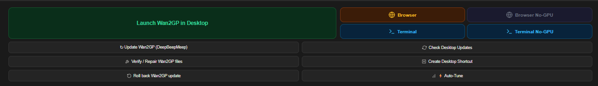

- **Desktop** — Wan2GP embedded in the launcher: reload, zoom 25–200%, hide/show that keeps your session, and console-first boot (the view opens when the dashboard log says it's ready). Drag & drop into Gradio dropzones works, and new gallery arrivals pop a Save / Save As… prompt with real file-type filters.
- **Browser** — visible console, auto-opens when ready.
- **External Terminal** — a real Windows Terminal / cmd window via generated script; in-app LED + Stop.
- **No-GPU Chrome** — launches Chrome with GPU disabled to free VRAM for generation.
- **Browser picker** — detects Chrome, Edge, Firefox, Brave, Opera, Vivaldi.

### Where is everything? (defaults)

Three separate things, three places:

```
1) The launcher app itself (≈ 12 MB)   ← installed by the setup.exe
   %LocalAppData%\Wan2GP Desktop Launcher Tauri\
   Uses the WebView2 engine already in Windows — no bundled Chromium.
   (Machine-wide install goes to Program Files instead.)

2) Wan2GP + launcher data (self-contained, you pick the folder)
C:\Wan2GP\                      ← repo + launcher data
   ├─ wgp.py                    ← Wan2GP core
   ├─ env_uv\                   ← Python 3.11 venv (uv)
   ├─ wgp_config.json           ← settings (ckpts → C:\Wan2GP-Models\ckpts)
   ├─ desktop-config.json       ← launcher config (lives HERE, not in AppData)
   └─ boot.log                  ← diagnostic

3) Your large files (any drive you chose)
C:\Wan2GP-Models\               ← models library
   ├─ ckpts\                    ← checkpoints
   ├─ loras\                    ← LoRAs
   └─ outputs\                  ← generated videos/images/audio
```

> `C:\Wan2GP` / `C:\Wan2GP-Models` are pre-filled defaults — Browse to any drive/folder at install or later via **Dashboard → Migrate to new location**. A custom data folder is remembered in `%USERPROFILE%\.wan2gp-tauri-data-dir` (the old Electron pointer is followed automatically, so your install carries over).

## 🔥 What's New

> Full history with every fix: [CHANGELOG.md](CHANGELOG.md). All releases: [GitHub](https://github.com/GKartist75/Wan2GP-Desktop-Tauri/releases).

| Version | Headline |
| --- | --- |
| [**v0.10.24**](https://github.com/GKartist75/Wan2GP-Desktop-Tauri/releases/tag/v0.10.24) | **Shared output folders, Q4 KV cache, Civitai keys, Open Deepy in browser.** Manage → General now has separate **Image output** and **3D output** folders (WanGP's four `OUTPUT_KEYS`); new **Deepy KV Cache Quantization** dropdown (Auto/INT8/Q4, default Auto) with Auto-Tune recommending Q4 on tight VRAM (~24% less than INT8). Civitai API keys for civitai.com and civitai.red join the existing HuggingFace token. A one-click **Open Deepy in browser** button next to Start Deepy Web. Wheel pins bumped to WGPKernels 1.4.2 and GGUF 1.0.29. |
| [**v0.10.23**](https://github.com/GKartist75/Wan2GP-Desktop-Tauri/releases/tag/v0.10.23) | **GPU selection finally reaches Wan2GP.** Multi-GPU / iGPU+dGPU boxes hit a bare `CUDA error: out of memory` while VRAM read free because the launcher never passed `--gpu`, so upstream's `torch.set_default_device()` never ran. The picker now resolves the saved card (stored by UUID) to `--gpu cuda:N` with `CUDA_DEVICE_ORDER=PCI_BUS_ID`, clears inherited `CUDA_VISIBLE_DEVICES`, and Auto is a real choice (highest-VRAM card). *All GPUs visible* is the no-flag escape hatch. Auto-Tune, the hardware profile, install plan, topbar VRAM tile and troubleshoot bundle all follow the pinned card instead of summing every GPU. The Launcher GPU setting was a no-op (`WEBVIEW2_ADDITIONAL_BROWSER_ARGS` → the real `WEBVIEW2_ADDITIONAL_BROWSER_ARGUMENTS`, appended not overwritten); *Integrated* now uses the reliable `--disable-gpu` (SwiftShader) since `--force_low_power_gpu` is broken on v145+. AMD HIP pin counts discrete cards only (APUs excluded). A startup diagnostic line reports per-device VRAM, resolved UUID and live env. |
| [**v0.10.22**](https://github.com/GKartist75/Wan2GP-Desktop-Tauri/releases/tag/v0.10.22) | **The installer now shows every prerequisite with a live status and lets you fix it in place.** Git, uv, Python and Conda each get a row with a green/red dot, the detected version and resolved path, and **Install** (or **Reinstall**, with a confirmation) / **Check** / **Version** buttons plus **Check all** in the header. Reinstall really replaces: the launcher-owned uv copy is deleted first, and every install goes through the vendor installer/winget path instead of being skipped as "already installed" — one install at a time, so two winget runs never overlap. The bare-machine gate was fixed too: the card and the gate share one readiness probe, so a python.org install that keeps `py.exe` off `PATH` is detected instead of re-showing the card forever; venv installs use the GPU profile's Python minor (3.10 GTX 10 / 3.11 / 3.12 AMD) in the gate, the shim and setup.py; and the one-click Python pin follows the hardware. |
| [**v0.10.21**](https://github.com/GKartist75/Wan2GP-Desktop-Tauri/releases/tag/v0.10.21) | **Manage → System now cleans the disk caches Wan2GP rebuilds anyway.** One measured list — Gradio temp (`%TEMP%\gradio`), the `uv` wheel cache, the launcher wheel cache, the Triton JIT cache, pip's download cache and the HuggingFace hub cache — with **Clean selected** emptying the folders in place (byte/file summary, per-item errors for anything locked) while Wan2GP is stopped. **The HuggingFace hub row is red and ticked off by default**: weights pulled through `huggingface_hub` live only in `hub/` and are re-downloaded, whereas models in your model folder and your HF token stay untouched. The backend re-checks every path against an allow-list plus a root/ancestor guard, and the old uv-only *Calculate size / Purge unused / Remove cache* trio — wired to a stub that reported success and deleted nothing — is gone; the `uv` row here really empties `.uv-cache`. |
| [**v0.10.20**](https://github.com/GKartist75/Wan2GP-Desktop-Tauri/releases/tag/v0.10.20) | **The Finetune Manager is opt-in — the launcher stops installing a companion plugin you did not ask for.** On fresh installs, after Repair and at startup the pinned Finetune Manager is no longer seeded automatically: the *Manage → Plugins* checkbox arrives ticked, **Install / repair** still does it on demand, and existing installs keep theirs. **AMD ROCm no longer guesses the device target** — tiers follow the real architecture per name (RDNA 2/3/3.5/4 plus 680M/660M/610M, Rogue Ally Z1, Strix Point/Halo, Phoenix/Hawk Point 780M) and Settings → AMD ROCm gained a **GPU device target** (auto or a pin such as `gfx1036,gfx1201`), with an actionable refusal when Windows reports only a generic adapter and nothing else can tell. **Multi-GPU and driverless boxes are detected honestly** (largest card wins, discrete beats iGPU, a Microsoft Basic Display Adapter surfaces so the preflight can refuse), the **console log server** is token-gated and host-checked against DNS rebinding, the Install tab's *Profile:* chip shows the backend's own resolved tier, and the topbar CPU tile no longer goes stale on a real 0% while the AMD compute probe runs the real int8 GEMM. WanGP **v18.21** parity is guidance-only (FlashVSR+ Turbo default, H3 PDD base-model LoRAs, compute-capability kernel gating). |
| [**v0.10.19**](https://github.com/GKartist75/Wan2GP-Desktop-Tauri/releases/tag/v0.10.19) | **The Pack tab is gone — model-pack management now belongs to the Finetune Manager plugin.** The launcher installs that plugin from a pinned release (repair or opt out under Manage → Plugins), and the 6.9k-line pack backend, its pinned catalog, the verify/refresh scripts and the pack test suite are deleted; files you already downloaded stay visible in the Library. Auto-Tune also tracks WanGP v18.20, and the Performance panel stops writing settings that did nothing. `vram_safety_coefficient` follows upstream's new **0.85** default (0.70 under 12 GB, 0.60 failsafe) instead of the retired 0.80; **Manual VRAM Preload** gains the megabytes it was missing — the mode was written but the amount had no control, so it preloaded 0 MB; **Language Models CPU Compute** (`llm_cpu_compute`, Auto / On / Off) is now settable, so Deepy and the prompt enhancer can use the CPU while their layers stream from RAM; and **P0** becomes Auto-Tune's preferred profile under 32 GB of RAM, named above the matrix. Bundled with the v18.20 parity work: GGUF 1.0.28, WGPKernels 1.3.0 for RTX 20XX+, FastH3 Omni and Fibo 2.0 in the Guide, and a Delete button on every Library model row |
| [**v0.10.18**](https://github.com/GKartist75/Wan2GP-Desktop-Tauri/releases/tag/v0.10.18) | **Pack/CivitAI gets the details right, custom resolutions are editable, and DLSS 5 now follows DeepBeepMeep/Wan2GP.** CivitAI LoRAs install as LoRAs, public releases need no token, installs are recorded from the real files on disk, and only weight files are fetched (HIGH/LOW halves become the two Wan 2.2 phases). Finetune JSON now matches upstream's `FINETUNES.md` (`model.infos`, `loras_multipliers`, reusable `URLs`/`URLs2`), **Manage → General** gains a validated `resolutions.json` editor, the Library labels every checkpoint/finetune as DeepBeepMeep / Pack / Yours and fixes the checkpoint table's column widths, and the Pack tab puts the in-development disclaimer and catalogue first. **DLSS 5** verifies files immediately after install (green only when the SHA matches), treats a failed installer exit as a failure even over an old complete install, mirrors current upstream's workstation GPU tier, and *Compare with upstream* now compares your checkout with `deepbeepmeep/Wan2GP` main — component release feeds are no longer update sources |
| [**v0.10.17**](https://github.com/GKartist75/Wan2GP-Desktop-Tauri/releases/tag/v0.10.17) | **CivitAI is now an opt-in master switch, off by default.** While off, nothing contacts `civitai.red`: search, browse, inspect, examples, token checks and downloads all refuse locally, and both source pickers fall back to HuggingFace. Turning it on restores CivitAI; the 18+ gate stays independent. CivitAI search/browse use the API's own repeated `types=` spelling again (no more HTTP 400 on Trending), and download counts separate pending bytes from files already on disk, with the free-space check using the real LoRA/checkpoint folders |
| [**v0.10.16**](https://github.com/GKartist75/Wan2GP-Desktop-Tauri/releases/tag/v0.10.16) | **Pack LoRAs and checkpoints now land where Wan2GP actually scans.** LoRAs go to `<loras_root>/<collection>/adult-pack/` (following Wan2GP's `--loras`, `loras_root` and `--lora-config` precedence), checkpoints to `<checkpoint root>/adult-pack/` via upstream's `URL|subfolder` form. Files fetched by 0.10.15 are moved into place once when the Pack tab opens — nothing is re-downloaded, and your own checkpoints stay untouched |
| [**v0.10.15**](https://github.com/GKartist75/Wan2GP-Desktop-Tauri/releases/tag/v0.10.15) | **Manage → 📦 Pack becomes a general model manager, and its downloads become a queue.** The opt-in tab can now add a model Wan2GP doesn't ship — paste a HuggingFace repo or CivitAI URL (version picker, overridable LoRA-vs-checkpoint kind) — edit/export/import finetune recipes in a real form, inventory and delete the LoRAs on disk, and narrow the catalog to *not downloaded* → **Select shown** → *Download selected*, with one queue row per item (`3/7`, per-file state, ✗ failed) instead of a scrolling log. **DLSS 5 tells local truth**: a hash-matching component is green, the `↻ upstream` note appears only after *Check for updates*, verdicts survive a restart, and **Force** is remembered. Plus HuggingFace/Anthropic tokens are no longer left in a temp batch file, five more blocking commands moved off the UI thread, and the release script can no longer publish a stale installer |
| [**v0.10.14**](https://github.com/GKartist75/Wan2GP-Desktop-Tauri/releases/tag/v0.10.14) | **Confirmations actually ask again, and the VRAM graph stays visible.** `tauri-plugin-dialog`'s async shims made every `confirm()` a truthy Promise while the ACL rejected the native call, so all 26 confirmation/alert sites silently fell through — they now use the launcher's own `askConfirm`/`notifyUser`; the topbar status cluster is a **2×2 grid** (203px vs 364px), and its metrics row now drops whole lower-priority readings in tiers instead of clipping **VRAM** off the end; plus the audit pass (**DLSS SHA verify on demand**, a **crash log** for release aborts, the **safe-Sage family rule**, heavy commands moved off the UI thread) and the **sync transcript fixtures** |
| [**v0.10.13**](https://github.com/GKartist75/Wan2GP-Desktop-Tauri/releases/tag/v0.10.14) _(shipped in v0.10.14)_ | **Upstream v18.19 parity — hardened.** The **AMD/HIP GGUF wheel now installs in this env again** (ROCm 10 / torch 2.13 / Python 3.12, RDNA4-gated from the live env — the separate ROCm 7.14 environment is retired) with **GGUF 1.0.27** and the **272-model inventory** (MOSS-TTS v1.5, Krea 2 Edit v2); **kernel wheels are SHA-256-verified before pip sees them** (16 launcher pins + GitHub's published digest, cached in `wheel-cache`); **Agent API (MCP) parity** — upstream's `2.1` default plus the `--mcp-webui`/`--no-mcp-webui` autostart override and OAuth flags; and a **wheel-selection pass** so *Update GPU Wheels* can never hand a CUDA wheel to a ROCm box, or the HIP button a `cp312` wheel to a py3.11 env |
| [**v0.10.12**](https://github.com/GKartist75/Wan2GP-Desktop-Tauri/releases/tag/v0.10.12) | **Upstream v18.18 parity — the Bitdefender/Triton fix**: upstream now ships a **prebuilt CUDA helper** (HIP besides, experimental) for the recommended Triton range `3.7.0.post26–3.7.1.post27` — never JIT-compiled, so no fresh hash to distrust: **no antivirus exclusions, no TinyCC/MSVC step** on Windows/Python 3.11 (and AMD ROCm) stacks, with a **Prebuilt Helper** integrity row on the dashboard (missing/modified = AV quarantine, hover for the file) + **GGUF 1.0.26** (fixes H3 image-reference projections) + **Update GPU Wheels syncs Triton** so existing installs move onto the helper range + guide inventory complete again (270 models, new 3D-reconstruction section) |
| [**v0.10.11**](https://github.com/GKartist75/Wan2GP-Desktop-Tauri/releases/tag/v0.10.11) | **Roll back Triton to post24** (Troubleshooting: same reinstall-and-clear pinned to the previous known-good 3.6.x, import verified) + **AV guidance**: if your antivirus blocks fresh Triton builds, post24 is worth trying as a diagnostic — report which build your AV accepts |
| [**v0.10.10**](https://github.com/GKartist75/Wan2GP-Desktop-Tauri/releases/tag/v0.10.10) | **Repair Triton wheel** (Troubleshooting: force-reinstalls the exact installed build, torch untouched, clears both cache homes, verifies the import — for damaged installs, not AV verdicts) + **TCC vs MSVC stated plainly**: out-of-box stays pure upstream TinyCC; the signed-MSVC pin is a *temporary workaround* until upstream removes the runtime-JIT need |
| [**v0.10.9**](https://github.com/GKartist75/Wan2GP-Desktop-Tauri/releases/tag/v0.10.9) | **Window mode** (Settings → Desktop: windowed/maximized/fullscreen, persisted, applied live and at launch) + **Triton JIT hardening** (Bitdefender blocked `python.exe → tcc.exe` mid-generation): stable `<data>\triton-cache` dir, signed-MSVC `cl.exe` pin strictly opt-in (out-of-box stays pure upstream TinyCC) with a Settings choice, one-click MSVC Build Tools installer in Troubleshooting, INT8/FP8 live chips moved beside Running (shown only while known); **Performance Settings dropdowns reflect disk** (RAM allocator no longer stuck on "unset") |
| [**v0.10.8**](https://github.com/GKartist75/Wan2GP-Desktop-Tauri/releases/tag/v0.10.8) | **Upstream WGPKernels 1.1.2** — v1.1.1 downloads were deleted upstream (404), so the button, sync and overview target 1.1.2 (`cu130`/`cu128`/new `rocm100`); **AMD needs no separate env for WGPKernels anymore** — the `rocm100` wheel installs in place on RDNA4 (RX 9060/9060 XT *and* 9070 series) and Sync picks it up from `setup_config.json`; INT8 wording follows upstream (WGPKernels "recommended", Kitchen "fastest but least precise") |
| [**v0.10.7**](https://github.com/GKartist75/Wan2GP-Desktop-Tauri/releases/tag/v0.10.7) | **Upstream v18.11 parity** — Flux 3 Klein + Fish Audio Drama 3, WGPKernels 1.1.1 as an opt-in INT8 wheel (auto-picked per torch build, incl. experimental AMD rocm714 with a guided separate-env recipe), `fp8_kernels` + Text Encoder Quant in Performance Settings and Auto-Tune, GGUF 1.0.25 controls; **honest hardware pins** — installer matrix and guides re-checked against `setup_config.json` (AMD Flash 2.8.4, per-GPU Triton pins, no Flash on RTX 20); **live INT8/FP8 backend chips** (Active Environment at the time — topbar pills since v0.10.9) plus a HAGS hint in the DLSS 5 check |
| [**v0.10.6**](https://github.com/GKartist75/Wan2GP-Desktop-Tauri/releases/tag/v0.10.6) | **Upstream v18.02 parity** — rewritten VAEs, H3 Veda Sparse, Kandinsky 6, Prism, CUDA Graphs, Blackwell Compute Cache, 11-model 3D stack (now shown in Active Environment) plus guide starters; **SageAttention fixed for CUDA Graphs** — post4 builds needed a triton fallback and ran slow, installer/sync/restore now use the fixed post6 build; **Stop no longer kills your own agent** — Stop/serve-toggle/app-close kill by recorded PID instead of sweeping port 4096 |
| [**v0.10.5**](https://github.com/GKartist75/Wan2GP-Desktop-Tauri/releases/tag/v0.10.5) | **The update notice no longer moves your buttons** — the green strip is gone from the dashboard; the state lives on the *Check Desktop Updates* button itself (*Update available — v0.10.5*, pulsing dot, and pressing it downloads then installs), announced once by a clickable toast |
| [**v0.10.4**](https://github.com/GKartist75/Wan2GP-Desktop-Tauri/releases/tag/v0.10.4) | **Upstream v17.17 parity** — a new **RAM allocator** control beside VRAM that hands freed CPU-tensor RAM back to the system instead of hoarding it all session; **the console is resizable in every dock** — drag its edge to trade GUI space for log space, up to the whole window, with a Full mode for Browser; and every console message gets its own line again |
| [**v0.10.3**](https://github.com/GKartist75/Wan2GP-Desktop-Tauri/releases/tag/v0.10.3) | Long Auto-Tune values stop overlapping neighbouring fields; Restore names what it installed; Sync no longer re-downloads 282 MB of wheels you already have |
| [**v0.10.2**](https://github.com/GKartist75/Wan2GP-Desktop-Tauri/releases/tag/v0.10.2) | Light theme survives a relaunch; Update says *"Already at upstream"* instead of doing a no-op |
| [**v0.10.1**](https://github.com/GKartist75/Wan2GP-Desktop-Tauri/releases/tag/v0.10.1) | **Upstream v17 (MMGP v4) parity** — Profile 4 is up to 50% cheaper in VRAM, and nine new upstream settings are calibrated per hardware instead of left for you to hand-enable |
| [**v0.10.0**](https://github.com/GKartist75/Wan2GP-Desktop-Tauri/releases/tag/v0.10.0) | Internal: renderer split into 35 per-panel files, first test suite, ~2,200 lines of dead Electron code removed |
| [**v0.9.2**](https://github.com/GKartist75/Wan2GP-Desktop-Tauri/releases/tag/v0.9.2) | AMD correctness — RX 9060 / 9060 XT get the right `gfx1200` wheels; memory probing fails toward smaller profiles |
| [**v0.9.1**](https://github.com/GKartist75/Wan2GP-Desktop-Tauri/releases/tag/v0.9.1) | Opt-in console log viewer on its own port (phone included) |
| [**v0.9.0**](https://github.com/GKartist75/Wan2GP-Desktop-Tauri/releases/tag/v0.9.0) | AMD ROCm 10 refresh — unified `AMD` profile, Python 3.12, pinned torch 2.13 |
| [**v0.8.x**](https://github.com/GKartist75/Wan2GP-Desktop-Tauri/releases) | Pin-aware updates, stash-free updates, phone & remote access, queue notifications, plugin manager, DLSS5 |

---

## Screenshots

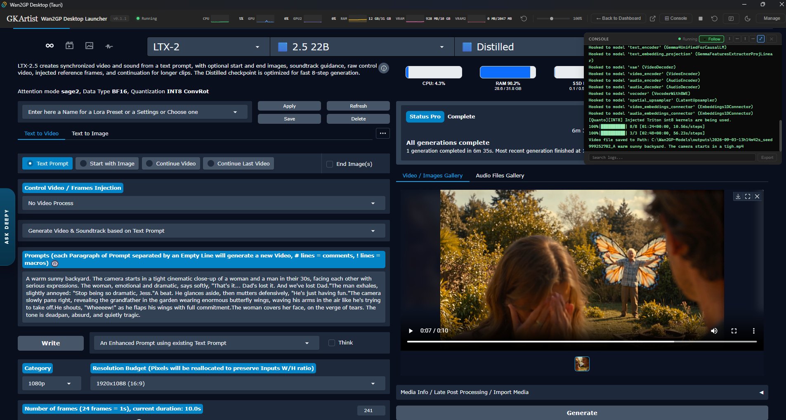
*Desktop view: Wan2GP (LTX-2.5 Distilled) embedded, floating console streaming the live log, topbar CPU/GPU/RAM/VRAM sparklines.*

<table>
  <tr>
    <td><a href="screenshots/autotune-int8.png">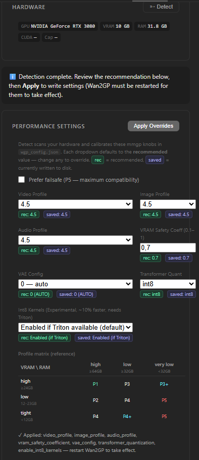</a><br><sub>Auto-Tune — hardware detection with rec/saved tags</sub></td>
    <td><a href="screenshots/env-kernel-wheels.png">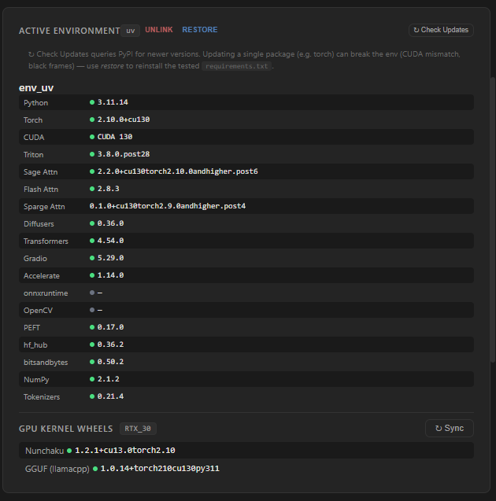</a><br><sub>Active Environment — installed packages and GPU kernel wheels</sub></td>
  </tr>
  <tr>
    <td><a href="screenshots/deepy-prime-engines.png">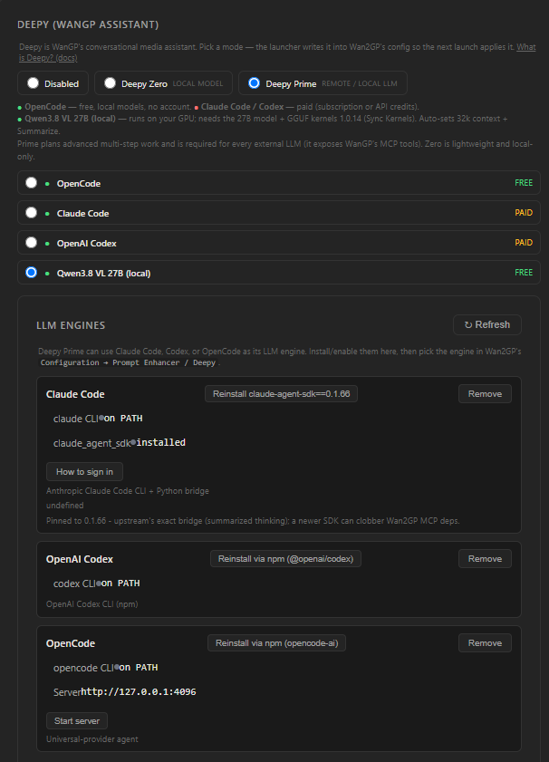</a><br><sub>Deepy Prime — local Qwen3.8 + remote LLM engines</sub></td>
    <td><a href="screenshots/plugins-manager.png">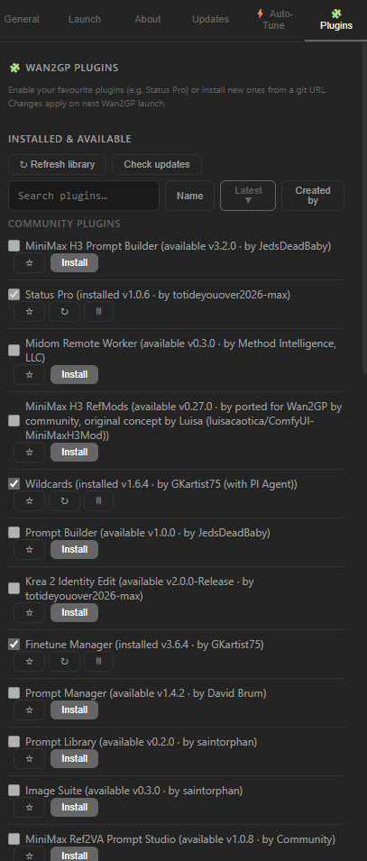</a><br><sub>Plugin Manager — community catalog, install, update, favourites</sub></td>
  </tr>
  <tr>
    <td colspan="2"><a href="screenshots/dlss5-checklist.png">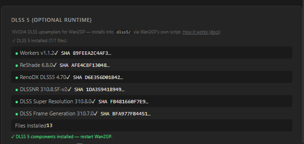</a><br><sub>DLSS5 installer — live per-component checklist with SHA-256 verification</sub></td>
  </tr>
  <tr>
    <td colspan="2"><a href="screenshots/custom-resolutions.png">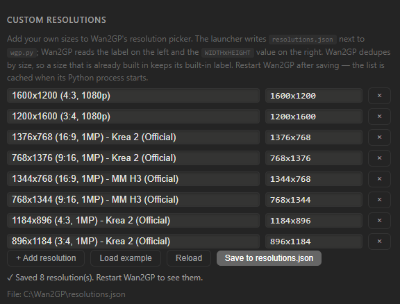</a><br><sub>Custom resolutions — validated <code>resolutions.json</code> editor (Manage → General)</sub></td>
  </tr>
  <tr>
    <td colspan="2"><a href="screenshots/launcher-overview.png">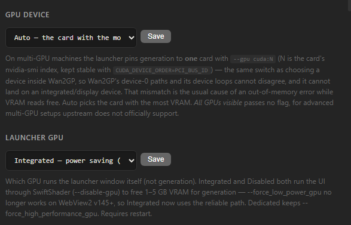</a><br><sub>Launcher — main view</sub></td>
  </tr>
  <tr>
    <td colspan="2"><a href="screenshots/deepy-browser-open.png">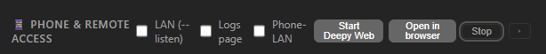</a><br><sub>Deepy — Open in browser button next to Start Deepy Web</sub></td>
  </tr>
</table>

---

## Why Tauri?

Same launcher, same Wan2GP, same features — lightweight native shell. It uses the **WebView2 engine already built into Windows 10/11** and a compiled **Rust** backend. No bundled browser, no Node runtime.

- Installer download: **≈ 3 MB**
- Installed app: **≈ 12 MB**
- Idle RAM (launcher shell): **~30–80 MB (shared system WebView2)**
- Startup: **near-instant native boot**
- Backend: **compiled Rust (memory-safe, no GC pauses)**
- Updates: **small NSIS/MSI patch**

**What that means for generation:** the launcher is not the part that renders video — but every MB of RAM and VRAM it doesn't waste stays available for models. The Tauri shell idles at a fraction of the footprint, and the **Launcher GPU** setting (Integrated / Disabled-SwiftShader) can push the UI off your NVIDIA card entirely, freeing **1–5 GB VRAM** for Wan2GP.

**Your install carries over:** the entire frontend (dashboard, installer, Auto-Tune, Deepy panels, consoles) is the same HTML/CSS/JS. Your `C:\Wan2GP` install, `C:\Wan2GP-Models` library, `wgp_config.json` and `desktop-config.json` carry over untouched — a custom data-dir pointer is followed automatically.

---

## What you get

**WanGP by [deepbeepmeep](https://github.com/deepbeepmeep/Wan2GP)** is a one-stop super-app for open-source generative models — video, image, audio and TTS — with a full browser UI, queue, galleries, LoRAs, finetunes and plugins. It runs on as little as **6 GB VRAM** and supports old and new GPUs alike. Through this launcher you get the **full WanGP** — same models, same UI, same plugins. Nothing stripped.

| Modality | Supported models (via launcher) |
| --- | --- |
| **Video** | **Wan 2.1 / 2.2** + derivatives, **MiniMax H3** (FL2VA / Ref2VA), **LTX-2 / 2.3 / 2.5**, **HunyuanVideo 1 / 1.5**, **LongCat, Kandinsky, LTXV, MagiHuman, VACE** |
| **Image** | **Krea 2, Qwen Image, Z-Image, Flux 1 / 2** (Klein, Chroma), **SenseNova, Ideogram 4, HiDream, Flux Kontext** |
| **Audio / TTS** | **Qwen3 TTS, AceStep 1/2/XL, Omnivoice, IndexTTS 2/2.5, KugelAudio, HeartMula, Chatterbox, Minimax Music, Stable Audio 3, YuE2, AuK Speech, Scenema Audio, DramaBox** |

**Run on more hardware:** 6 GB VRAM is enough for select models (up to 24 GB+ for max quality). NVIDIA GTX 10xx/16xx, RTX 20xx/30xx/40xx/50xx · AMD RDNA 2/3/3.5/4 · Apple Silicon (via upstream). Quantized checkpoints (int8, fp8, GGUF, NV FP4, Nunchaku) with architecture-aware downloads. Full web UI: galleries, templates, mask editor, background remover, pose/depth/flow, diarization, upsampling (RIFE/FlashVSR/Lanczos/SeedVR2), MMAudio/SeedVC, **20+ community plugins**, LoRAs, finetunes, queue, headless/API mode.

> Upstream docs: [WanGP README](https://github.com/deepbeepmeep/Wan2GP) · [Installation](https://github.com/deepbeepmeep/Wan2GP/blob/main/docs/INSTALLATION.md) · [Models](https://github.com/deepbeepmeep/Wan2GP/blob/main/docs/MODELS.md)

**What the launcher adds:**

- 🚀 **One-click install** — GPU detect → plan → preflight (Python pin, disk space, drivers, folder triage) → live progress. Missing Git/Python/uv installs silently, no PATH editing.
- 🧰 **Prerequisites you can see and fix** — Git / uv / Python / Conda rows with a live status dot, detected version and resolved path; **Install** or **Reinstall** (uv's launcher copy wiped first), **Check**, **Version**, and **Check all**.
- 🎯 **Always the right kernels** — per-GPU wheels from WanGP's `setup_config.json`, re-synced on install and every update, plus launcher safety overrides (GGUF floor, sage safe build) with one-click pure-upstream Restore.
- 📂 **Clean data layout** — `C:\Wan2GP` (app) + `C:\Wan2GP-Models` (models), both editable to any drive/folder; migrate later via Dashboard → Paths.
- 📐 **Custom resolutions** — **Manage → General** edits Wan2GP's `resolutions.json` in its own `[[label, "WxH"], …]` shape. Rows are validated (positive size, no duplicate labels/sizes), writes are atomic, and **Load example** fills eight 1080p / 1 MP Krea 2 and MiniMax H3 sizes. Restart Wan2GP after saving.
- 🖥️ **Flexible launch** — Desktop embed, Browser, or External Terminal; pop-out, zoom, browser picker.
- 🗂️ **A console you can size** — drag the edge that faces Wan2GP to trade GUI space for log space, in every dock (bottom / top / left / right / floating) and on the Dashboard card, up to the whole area below the topbar. Each dock remembers its own size across restarts; **⤢ Full** gives the console the entire dashboard, which is what you want in Browser mode where the console *is* the view.
- 🎨 **5 themes + text sizing** — Mono (default), Blue Sky, Orca, Cyber, Matrix; every theme editable (accent/background/text, live preview, Save/Set-as-default/Reset), topbar palette quick-switch, Text + Terminal size sliders in Manage → Appearance.

<table>
  <tr>
    <td><a href="screenshots/appearance-themes.png">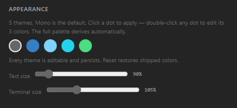</a><br><sub>Appearance — 5 themes, Mono default, click to apply</sub></td>
    <td><a href="screenshots/appearance-editor.png">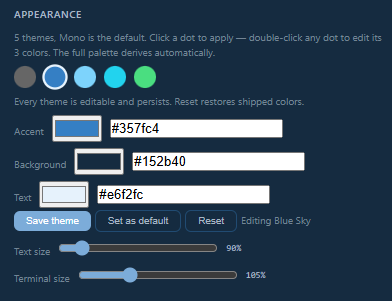</a><br><sub>Appearance editor — 3 colors per theme, Save/Set-as-default/Reset</sub></td>
  </tr>
</table>

- 🔄 **Safe updates** — manual-only, version-aware, from Dashboard / Manage → Updates.
- 🛡️ **Crash-proof UI** — crash recovery restores your session.
- 🧩 **Pinokio coexistence** — Pinokio installs detected and left untouched; one click reuses their model library, no re-downloads.

---

## 🛟 Troubleshooting — upstream's guide, as buttons

**Manage → Troubleshooting** turns WanGP's own `docs/TROUBLESHOOTING.md` into controls instead of copy-paste command lines. Read-only checks first; anything that writes backs up or asks.

| Button | What it does |
| --- | --- |
| **Diagnostics** | CUDA smoke test, real GEMM + INT8 compute check, Triton import, port owner + one-click fix, Windows long-paths status |
| **Failsafe (P5)** | Drops every profile to minimum-compatibility, backs up `wgp_config.json`, sets an SDPA fallback so the next boot works |
| **Known-good settings for this GPU** | Upstream's per-class recipe, shown before anything is written |
| **Out-of-memory remedies** | One click for Head Split → Medium or Lower Reserved RAM with pinning on |
| **Windows VRAM** | *Who is using VRAM* (per-process) and *Trim idle VRAM* |
| **Verbose logging** | Launches WanGP with `--verbose 2` so the console captures upstream's own diagnostics |
| **Debug bundle** | One click copies a report for Discord or GitHub |

**The known-good recipe** per card: `sdpa`/P4 on GTX 10xx · `sage`/P4 on RTX 20xx · `compile`/`sage2`/P3 on RTX 30–40xx · `sage2`/P4 on RTX 50xx. Only keys that really exist in `wgp_config.json` are written — Tea Cache and fp16 have no upstream key, so they are reported as *"set this in WanGP"* rather than saved as settings that would silently do nothing. AMD and Intel get no recipe; upstream publishes none.

**Head Split is a real trade.** Upstream's figure is ~2 GB less VRAM for ≤3% slower steps on H3 1080p/362 frames — same quality, but details and sometimes the motion can differ. Both remedies go through the same validated, backed-up write path as Auto-Tune.

> ⚠️ **Trim idle VRAM** briefly applies memory pressure and the screen can flash — it asks first. *Who is using VRAM* reads `gpumem.cmd`; WDDM hides per-process GPU memory from `nvidia-smi`.

> **Details and full button list:** [User Guide → Manage → System](docs/USER-GUIDE.md#manage--system)

---

## ⚡ Auto-Tune — one click, right profile

**Manage → Auto-Tune** (or ⚡ on the dashboard) reads your GPU, VRAM, RAM and kernels, then recommends the right `wgp_config.json` settings. Detect only proposes — **Apply Overrides** is the only thing that writes, and it refuses while WanGP is running.

**VRAM × RAM profile matrix**

| VRAM ↓ \ RAM → | ≥64 GB | ≥32 GB | <32 GB |
| --- | --- | --- | --- |
| **≥24 GB** | P1 max perf | P3 | P3+ RAM saver |
| **12–23 GB** | P2 | **P4 balanced** | **P0 low RAM** |
| **<12 GB** | **P4** | **P4** | **P0 low RAM** |

Profiles run 1 (max performance) to 5 (failsafe). **P0** (upstream v18.20, *More Speed with Less RAM*) is the preferred pick under 32 GB of RAM: it loads models part by part exactly like P4, but nothing keeps Reserved RAM for good — the running model borrows it and hands it on at the next switch. With under 32 GB there is no room for P4's or P5's permanent reservation, which is why P0 owns both `<32 GB` cells; P5 stays the failsafe net behind the switch. Upstream still labels P0 experimental, and the panel says so in the recommendation line. Upstream v17 made Profile 4 up to 50% cheaper in peak VRAM, so a card under 12 GB with ≥32 GB of RAM no longer has to drop to the failsafe net — it gets **P4 plus Attention Head Split** instead, which buys ~20% more VRAM for a few percent of speed. **Prefer failsafe** still forces P5 everywhere.

**Two honest caveats.** Attention Head Split does not reproduce the input exactly: same quality, but details — and sometimes the motion — can differ. And most of the v17 gain assumes Sage2 attention, which Auto-Tune does *not* switch for you — that stays yours via Performance Settings or the known-good recipe under Troubleshooting. Head split is on by default because VRAM headroom is the failure mode that stops generation outright; turn it Off in one click if you want bit-identical output.

Audio lands on **P3** almost everywhere, even where video gets P4 — audio models fit whole in VRAM, where upstream's own default applies. Deliberate exceptions: P0 and P5 inherit the video profile (neither keeps Reserved RAM, so there is nothing to hand audio), and P1/P3/P3+ are left alone.

Settings written: `video/image/audio_profile`, `transformer_quantization`, `text_encoder_quantization`, `int8_kernels`, `fp8_kernels`, `kernel_precision`, `vae_config`, `vram_safety_coefficient` (0.85, or 0.70 under 12 GB), plus the v17 levers (`attention_mode`, `vram_allocator`, `attention_head_split`, `smart_memory_pinning`, `*_preload_mode`, `perc_reserved_mem_max`). The panel also writes what Auto-Tune never recommends: the `*_preload_in_VRAM` megabytes a **Manual** VRAM Preload keeps, and `llm_cpu_compute` — *Language Models CPU Compute* (Auto / On / Off), which decides whether the CPU helps Deepy and the prompt enhancer while their layers stream from RAM. **These are CUDA-only** — on AMD and Intel Auto-Tune leaves them unset rather than persisting a setting that silently does nothing. Conditions are stated in the panel itself: the allocator needs a restart, pinning reloads the model, head split only engages at ≥8192 tokens.

A fresh install seeds the recommended values once, with setdefault semantics, so day one is already calibrated. An update never re-seeds over settings you tuned.

> **What each setting does, and when to override it:** [User Guide → Manage → Auto-Tune](docs/USER-GUIDE.md#manage--auto-tune)

---


## 📊 Monitoring & control

- **Dockable console** — live server log in green-on-black, dock to bottom/left/top or float. Search, export, **Clear**.
- **Topbar sparklines** — CPU/GPU/RAM/VRAM mini real-time charts.
- **Running LED & Stop** — status light + one-click server stop. Once WanGP reports them at boot, `INT8 · <backend>` / `FP8 · <backend>` pills sit beside it with the same kind of dot: green = accelerated kernel in use, amber = PyTorch fallback, grey = not reported yet.
- **Auto-start with Windows**, notifications on server ready/stop.
- **Queue notifications** — sets up Wan2GP's native Apprise destinations (Telegram/Discord/ntfy.sh…) in `wgp_config.json`, Install covers `apprise` + `keyring`; legacy log-driven sender stays for older Wan2GP.
- **Keyboard shortcuts** — <kbd>Esc</kbd>/<kbd>Ctrl+W</kbd> close webview.
- **Maintenance** — update WanGP or the launcher from **Dashboard** or **Manage → Updates**, switch envs, or uninstall from the UI. **Dashboard → Paths** migrates installs between drives.

---

## 🔧 GPU kernels — the right ones, automatically

WanGP is faster with vendor kernels than stock PyTorch. You never pick them: the launcher reads WanGP's own `setup_config.json`, shows you exactly what it will install before it does, and re-syncs on install and after every update.

- **Per-GPU sets** — RTX 20 → Sage 1.0.6 + Nunchaku + GGUF + bitsandbytes · RTX 30/40 → adds Sparge + Sage 2.2.0 · RTX 50 → adds LightX2V FP4 · AMD → ROCm 10 stack, Sage 1.0.6, SDPA default.
- **Versions follow upstream** — a future bump in `setup_config.json` installs with no launcher update. The in-app GPU Kernel Wheels card is always authoritative; this README intentionally does not restate version numbers.
- **Launcher safety overrides** — a GGUF floor and the Sage post6 safe build, both restorable to pure upstream with **Restore GPU Wheels**.
- **Verified, not assumed** — after every Wan2GP update a compat check runs and says so in the Console. Unknown future components skip loudly instead of silently.

> **Full wheel table, per-GPU sets, driver requirements and the AMD/Intel notes:** [User Guide → GPU kernel wheels](docs/USER-GUIDE.md#gpu-kernel-wheels--what-gets-installed-per-gpu)

---


## Deepy — your offline agent

Configure without editing JSON: **Settings → Deepy** or the Dashboard card. Switching re-renders the picker live; **Apply** writes a consistent `wgp_config.json` (with backup).

| Mode | What it is |
| --- | --- |
| **Disabled** | Deepy off. Prompt enhancement still works with any local model (Florence or Qwen). |
| **Deepy Zero** | Local, no account or key. Qwen VL models. |
| **Deepy Prime** | Remote LLM via **OpenCode** (free), **Claude Code** or **Codex** (paid) — or a local **Qwen3.8 VL 9B/27B**. Prime exposes WanGP's MCP tools. |

**New here?** Start with **OpenCode** — the only zero-cost option.

Two more cards on the same screen: **Prompt enhancement** (Enhance Prompt button or Automatic dropdown, works with or without Deepy) and **Sessions** (multisession mode, per-session workspace, gallery media handling).

> **Model sizes, quantization choices and per-engine setup:** [User Guide → Dashboard](docs/USER-GUIDE.md#dashboard)

---


## 📱 Phone & remote access

One panel, three paths — **A** is everyday use, **B** and **C** are optional.

- **A · Gradio server** — flip the LAN (`--listen`) toggle and Gradio `/` plus the phone-friendly `/deepy/` are reachable from any device on your Wi-Fi: same conversation, galleries, progress and queue. This-PC and Phone URLs with Open / Copy / QR.
- **B · Deepy Web standalone** — a second process on its own port with its own conversation. Finish → stop → resume via saved sessions (it never live-syncs with A). Auth, LAN HTTPS, Tailscale, reverse-proxy origin and extra args all live here. A one-click **Open Deepy in browser** button next to **Start Deepy Web** launches the process (if needed) and opens its URL in your system browser.
- **C · Console logs** — a read-only tail of the same console as a web page on its own port, so you can watch errors from a phone without stopping the run. Trusted home Wi-Fi / Tailscale only — never port-forward it (no auth).

Flipping LAN while running offers a restart in place. Topbar keeps a Deepy Web LED next to the Wan2GP LED. All actions log `[Deepy]` lines to the Console.


One panel, two paths — pick one. **A · Gradio server** exposes Gradio `/` and the phone-friendly `/deepy/` together over a **LAN (`--listen`) toggle** (persisted, appended verbatim on launch; flipping it while running offers a restart in place): same conversation, galleries, progress and queue on every device, with This-PC and Phone URLs (Open/Copy/QR). **B · Deepy Web standalone** is a second process on its own port with its own conversation — Assistant selector (Zero/Prime per start), Same-PC / Phone-LAN addresses plus an **External** Tailscale row (Copy + QR), Auth (Off / fixed passphrase with generator), port (empty = auto, server port + 1), LAN HTTPS, reverse-proxy origin, Extra args, Start/Stop. Standalone never live-syncs — finish → stop → resume via saved sessions. Address URLs are click-to-open in the real browser (login must happen in a tab — embedded views 403). Topbar shows a persistent Deepy Web LED (green = running, red = stopped) next to the Wan2GP LED. All actions log `[Deepy]` lines to the Console. Left info cards collapse (chevron, remembered) while keeping key actions live in the header.

<table>
  <tr>
    <td><a href="screenshots/deepy-web-phone-app.jpg">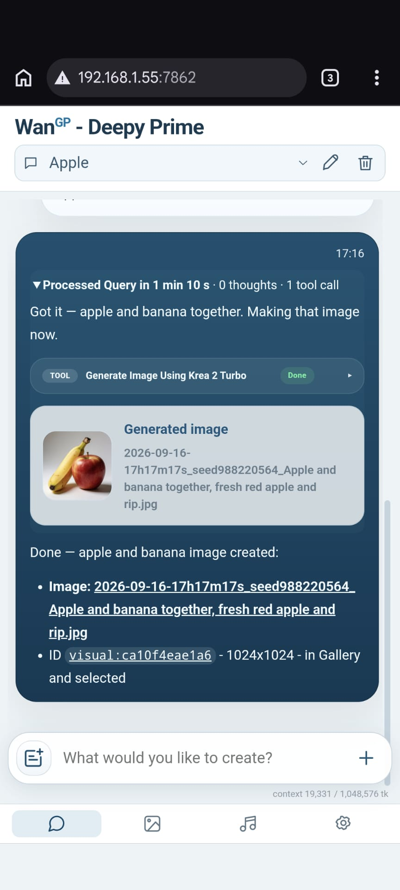</a><br><sub>Deepy Web on a phone — Prime session generating an image</sub></td>
    <td><a href="screenshots/deepy-web-desktop-prime.png">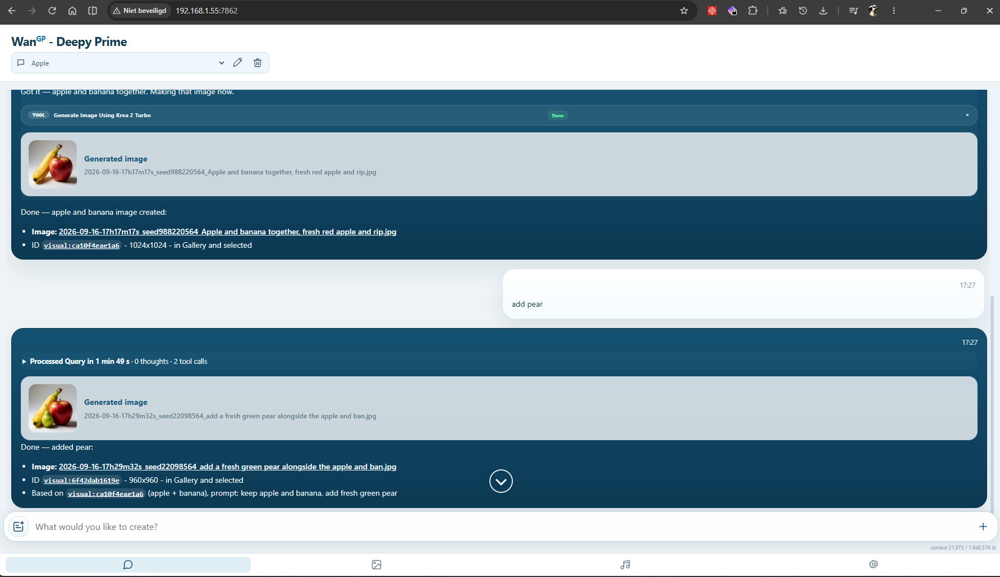</a><br><sub>Deepy Web on desktop — Prime multi-turn session with follow-up edit</sub></td>
  </tr>
  <tr>
    <td><a href="screenshots/deepy-web-settings.png">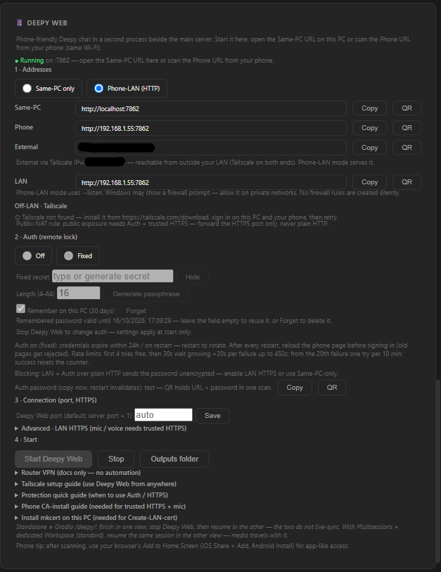</a><br><sub>Deepy Web card — addresses, auth, connection, start</sub></td>
    <td><a href="screenshots/deepy-prime-panel.png">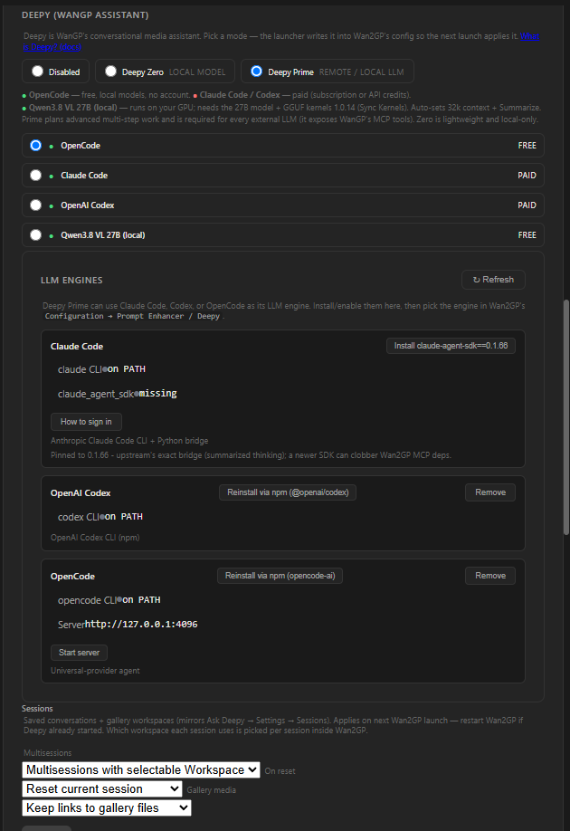</a><br><sub>Deepy Prime panel — engine picker, LLM engines, sessions</sub></td>
  </tr>
  <tr>
    <td colspan="2"><a href="screenshots/deepy-zero-panel.png">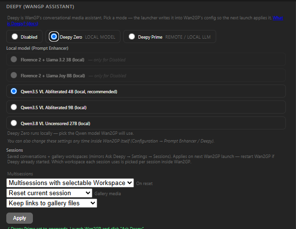</a><br><sub>Deepy Zero panel — local Qwen model picker</sub></td>
  </tr>
</table>


---

## 🧩 Plugin Manager

**Manage → Plugins** lists WanGP's catalog merged with your installed `plugins/` folder (system vs community grouping), with search, Name/Latest/Author sort, and per-plugin enable checkboxes. From a git URL you can install (clone + `requirements.txt` + enable), per-plugin ↻ check/update, 🗑 uninstall, library refresh, and check-all-updates — all with console progress.

- **Status Pro** is uninstalled by default (temporarily incompatible with the current Deepy update): no longer auto-installed or force-enabled, and removed from existing installs — reinstall/enable it manually once fixed.
- **★ Favourites** auto-install on fresh setup (stored in `desktop-config.json` → `favoritePlugins`).
- Changes apply on next Wan2GP launch.

<a href="screenshots/plugins-manager.png"></a>

## ✨ DLSS5 installer — optional NVIDIA upsamplers

Dashboard card runs WanGP's own `scripts/install_dlss5.ps1` (workers v1.1.3, ReShade 6.8.0, RenoDX 4.70, DLSSNR 310.8.SF-v2, DLSS 310.8.0, Frame Generation 310.7.0) into `C:\Wan2GP\dlss5\` with a live per-component checklist — downloading → SHA-256 ✓ → installed — plus console progress.


- Strict consent: type `I ACCEPT` (third-party binaries are community-hosted, unsigned, proprietary — see [docs/DLSS5.md](https://github.com/deepbeepmeep/Wan2GP/blob/main/docs/DLSS5.md)).
- **Force** backs up + replaces conflicting files, and is **remembered across restarts** — it changes what an install does to files already on disk, so losing the tick shouldn't silently change the result. **Stop Wan2GP first.** (The consent tick in the install modal is deliberately **not** remembered; consent is per-install.)
- Needs Windows 11 + RTX 30+ (Neural Rendering, 30 experimental) / RTX 40+ (Frame Generation) + HAGS.
- **Check compatibility** reports per-mode verdicts (ready / not-installed / blocked) with GPU tier, files, HAGS, and the frame-gen probe — and its file verdicts are **remembered between launches** (revalidated against the pin, the file's size and its mtime), so the card opens with real ticks instead of *expected*. Current Wan2GP already tiers workstation cards natively; older checkouts can still use the patch below.
- **Green means local truth**: a component whose SHA matches what DeepBeepMeep/Wan2GP pins shows a green dot (unhashed-but-present is amber, missing/wrong bytes red). A successful install now verifies the files immediately, and a failed installer exit is reported as a failure even if an older complete install left every file present. **Compare with upstream** is read-only: it compares the pins in your Wan2GP checkout with `scripts/install_dlss5.ps1` on `deepbeepmeep/Wan2GP` main and says *update Wan2GP, then run Install / update DLSS 5* when the upstream pin is newer. Component release feeds are not update sources, and the `↻ DeepBeepMeep/Wan2GP pins …` note appears only after you press it.
- **Workstation GPU fix** (opt-in) — patches older Wan2GP's GeForce-only GPU check so RTX PRO / Ada / RTX Ax000 / L40 / Hopper cards pass DLSS gating. Backed up (`*.launcher-bak`), reversible, refuses on upstream drift. Current Wan2GP needs no patch.

> ⚠️ **Untested on real workstation hardware** — the tiers logic are simulated only (PRO 5000→50, 5000 Ada→40, A6000→30). Confirm on a PRO/A-series card before relying on it.

---

## 🧭 Guide & 📚 Library

**Guide** (topbar tab, next to Manage) answers *what to make and with what*: goal picker with curated model picks + starter settings (copy the full model name into WanGP's toolbar search), 6 prompt templates with the line mode each needs, offline `[/...]` window-command checker, VACE pre-flight checklist, post-processing at a glance. Read-only — nothing changes until you pick inside WanGP. Full walkthroughs: [docs/WAN2GP-GUIDE.md](docs/WAN2GP-GUIDE.md) — all 272 models and 116 settings.

**Manage → Library** inventories what's on disk: downloaded checkpoints with **DeepBeepMeep / Pack / Yours** provenance, sizes and kind tags; LoRA families split into **Pack** and **Yours** counts/sizes with known URLs; finetunes labelled **Pack**, **Pack · CivitAI**, **Overrides DeepBeepMeep** or **Yours**, with validated JSON import/export and delete; workspaces (real sizes, missing-file flags, archive lock, definitions backup). The checkpoint table gives Checkpoint/Origin/Kind/Size real widths, so long filenames wrap normally.

### Gallery viewer

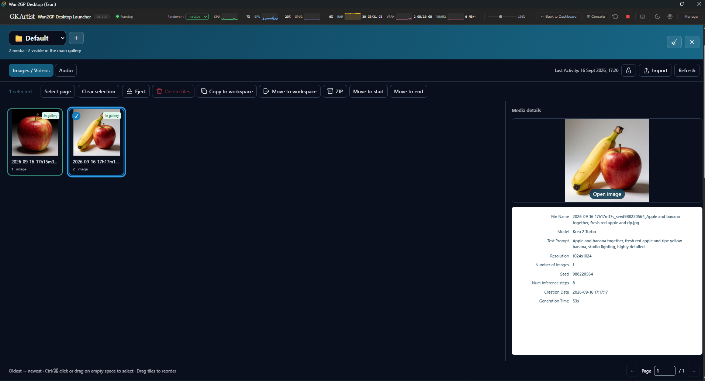

Full workspace viewer: multi-select, reorder, eject, copy/move across workspaces, ZIP download, import, delete (confirmed), media-details pane with prompt/model/settings. New arrivals pop Save / Save As… with proper `*.zip`/`*.json` filters.

**Manage → Launch** adds presets (Balanced / Low VRAM / Max perf / Emergency) + flag builder, an MCP command/URL helper, and a headless queue runner (`--process` with console streaming). **Manage → System** adds torch/CUDA probes to the issue bundle, config snapshots on every Apply (undoable restore), upstream changelog viewer, Deepy engine checks, and a **disk cache cleanup** panel — Gradio temp, uv/launcher wheel caches, Triton JIT, pip and HuggingFace hub caches with their real sizes, tick-to-delete, and a red warning where the folder holds model weights.

---

## Documentation

| Doc | For |
| --- | --- |
| [**User Guide**](docs/USER-GUIDE.md) | Every screen, tab and button — where things are and what they do |
| [**WanGP Guidance**](docs/WAN2GP-GUIDE.md) | Which model and settings to pick for your goal |
| [**System Overview**](docs/OVERVIEW.md) | How the launcher, upstream WanGP and your machine fit together — for contributors |
| [**CHANGELOG**](CHANGELOG.md) | Every fix, per release |

---

## 🛠 Build from source

Prerequisites: [Rust](https://rustup.rs/) (**1.95+** — `sysinfo` 0.39 uses edition 2024) + Node.js 22+. WebView2 comes with Windows.

```bash
git clone https://github.com/GKartist75/Wan2GP-Desktop-Tauri.git
cd Wan2GP-Desktop-Tauri
npm ci
npm run tauri -- build   # NSIS + MSI in src-tauri/target/release/bundle/
```

Backend lives in `src-tauri/src/lib.rs` (`#[tauri::command]` handlers); frontend is vanilla HTML/CSS/JS in `src/` calling them via `invoke()` (`src/w2gp.js` bridge).

### Tests

```bash
cargo test --manifest-path src-tauri/Cargo.toml   # 358 backend tests (1 ignored)
npm test                                          # 166 frontend tests
```

Both suites are hermetic — the backend one redirects `get_repo_dir()` at a
tempdir, so running it leaves your `C:\Wan2GP\wgp_config.json` untouched.

### Working on the UI

`src/app.js` is the shell; each panel lives in its own `src/*-tab.js`, all
listed in `index.html` after `app.js`. **That order is a contract** — a script
cannot reference a symbol a later script defines, because all scripts are
`defer` and therefore run in document order. `tests/load-order.test.js` enforces
it. To see a panel without a full build:

```bash
npm run harness          # serves src/ on http://127.0.0.1:4173 with Tauri IPC stubbed
```

---

## ⭐ Star History

If this launcher saved you a setup headache, leave a star — it helps others find it.

[](https://www.star-history.com/#GKartist75/Wan2GP-Desktop-Tauri&Date)

---

## Credits & License

Wan2GP Desktop Launcher wraps [Wan2GP](https://github.com/deepbeepmeep/Wan2GP) by deepbeepmeep.

The launcher itself is [MIT licensed](LICENSE). Wan2GP keeps its own upstream license; the opt-in adult model pack only links to third-party files and re-hosts nothing.

Discord: [WanGP Community](https://discord.gg/g7efUW9jGV) · X: [@deepbeepmeep](https://x.com/deepbeepmeep) · Site: [wangp.ai](https://wangp.ai/)
