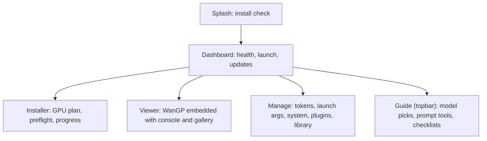
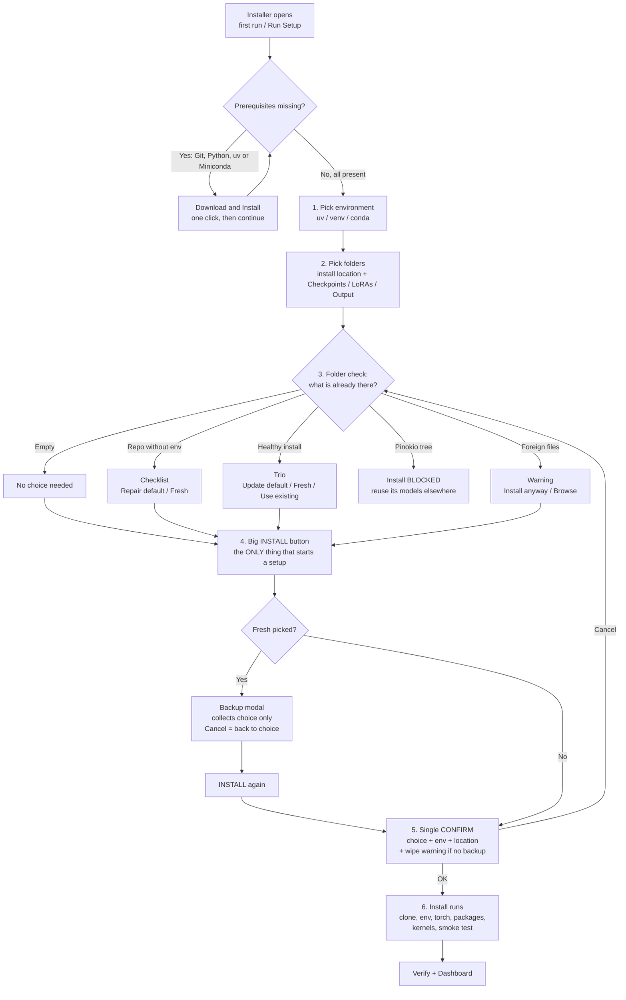

# Wan2GP Desktop Launcher — User Guide

Every screen, tab and button, and what it does. The launcher has three screens
(**Splash → Dashboard → Installer**) plus the **Manage** panel and the embedded
**Viewer**. Companion: [WanGP Guidance](WAN2GP-GUIDE.md) — which model and
settings to pick for your goal.

## Contents

- [Dashboard](#dashboard)
- [Installer (Setup)](#installer-setup)
- [Viewer (Desktop embed)](#viewer-desktop-embed)
- [Manage → General](#manage--general)
- [Manage → Launch](#manage--launch)
- [Manage → System](#manage--system)
- [GPU kernel wheels](#gpu-kernel-wheels--what-gets-installed-per-gpu)
- [Manage → Auto-Tune](#manage--auto-tune)
- [Manage → Plugins](#manage--plugins)
- [Manage → Library](#manage--library)
- [Finetune Manager (companion plugin)](#finetune-manager-companion-plugin)
- [Guide (topbar)](#guide-topbar)
- [Console & logs](#console--logs)
- [Typical workflows](#typical-workflows)

---

## Dashboard

The home screen. Top to bottom:

**Top bar**

| Button | What it does |
| --- | --- |
| ← Back to Dashboard | Leaves the Viewer, back to this screen |
| ⊞ Console | Toggles the floating terminal console |
| ⟳ (reload icon) | Reloads the Wan2GP view |
| ⏹ Stop All | Stops Wan2GP + OpenCode servers (also kills the port listener) |
| Task Manager | Opens Windows Task Manager |
| ☀/☾ | Toggles dark / light theme |
| 🎨 (palette) | Cycles the 5 Appearance themes (Mono → Sky → Orca → Cyber → Matrix) |
| ⚙ (gear) | Opens the Manage panel |

**Banners** (appear only when relevant):

- **Update available** — *Full Download* (complete package, always works, fixes corrupted installs), *Install & Restart* (incremental update), ✕ dismiss.
- **Dependency drift** — packages missing or outdated after a Wan2GP update (first few named); *Restore now* reinstalls the pinned set, *Dismiss* snoozes it until the next update.
- **SageAttention fix** (RTX 40/50 only) — the shipped Sage wheel has a known fp8 bug (false out-of-memory / stalling); *Sync Kernels* installs the stable build, *Dismiss* hides it.
- **Models location warning** — your data sits inside the roaming AppData profile; *Migrate to new location* moves it out.

**System card** — CPU, RAM, GPU, VRAM, GPU profile badge. Read-only health summary.

**Paths & Model Folders card** — where everything lives:

- *Wan2GP install location* — repo + Python env + settings. Folder icon opens it in Explorer, pencil icon moves it.
- *Checkpoints / LoRAs / Output* — model and output folders, each with open + change buttons.
- Keep models OUT of AppData/Roaming (tens–hundreds of GB, roams with your profile).
- New models are large (e.g. Qwen Image 2.1 ships bf16 + int8 safetensors plus encoder/VAE) and download on first use; the first H3 INT8 run also fetches its ConvRot VAE. Pre/post-processing checkpoints download on demand (upstream JIT), so the upfront footprint stays smaller than it looks.
- H3 Video VAE on Auto follows your Transformer Quantization choice (16-bit → BF16, FP8 → FP8 mixed, INT8 → INT8 ConvRot decoder); explicit BF16/FP8/INT8 choices in the Memory panel override Auto and are preserved.

**GPU Kernel Wheels card** — per-GPU wheels (torch, triton, sage/flash attention, nunchaku/GGUF) with installed versions. *↻ Update GPU Wheels* installs upstream's wanted set plus launcher fixes (sage safe build, GGUF floor that follows `setup_config.json` forward), *Restore GPU Wheels* reinstalls deepbeepmeep's pure upstream set. Sync follows your local checkout — if it is behind `origin/main`, the console warns you to update Wan2GP first, otherwise you install stale wheels. After every Wan2GP update the launcher also runs a compat check (setup_config shape + GGUF pins) and says so in the Console — re-run Sync when it reports new wheels. Every wheel is downloaded, SHA-256-verified and only then handed to pip: the launcher ships pins for the exact assets it knows, falls back to GitHub's published digest for a newer version, and aborts the component on a mismatch. Each install prints the hash it computed and whose digest it matched — e.g. `sha256 <hash> — matches the sha256 deepbeepmeep/WGPKernels published for release v1.1.2 (launcher pin)`, named from the wheel's own repo since Nunchaku and SageAttention ship from theirs — so the check is readable in the Console instead of a bare "verified". Verified wheels live in the launcher data folder's `wheel-cache` (safe to delete; it only saves re-downloading), and reusing a cached wheel re-hashes it and prints the same evidence.

**AMD and the experimental kernels (RX 9060 / 9070 series — gfx1200/gfx1201).** Both wheels now install straight into the installer's torch 2.13+rocm10 env — there is no separate environment any more:

- **WGPKernels (INT8)** — the INT8 fast path. One-click on NVIDIA RTX 20/30/40/50 (the launcher picks `cu130`/`cu128` from your torch build; Turing 7.5 is in since 1.3.0) and on AMD RDNA4 (the `rocm100` build installs right in the installer's TheRock torch 2.13+rocm10 env). *↻ Update GPU Wheels* also installs it now that upstream profiles list it.
- **HIP GGUF (exp)** — the AMD build of the GGUF wheel (1.0.28, `torch213rocm100py312`). It is built for **this** env — torch 2.13.0+rocm10.0.0 — and the wheel checks the ROCm torch build at import. *↻ Update GPU Wheels* lands it automatically on RDNA4; the button stays as a reinstall path.

RDNA 1–3.5 cards have **no** WGPKernels/HIP wheel. Upstream's own HIP validation is still pending (no RDNA4 board on their side), so treat the HIP path as experimental.

**Active Environment card** — the selected Python env (`uv`, `venv` or `conda`):

| Button | What it does |
| --- | --- |
| unlink | Removes the env from the launcher (asks first) |
| restore | Re-installs all packages from `requirements.txt` into the existing env (asks first) |
| reinstall | Recreates the whole env from scratch — fresh Python, PyTorch, packages, kernels. Models, plugins and settings are kept (asks first, takes a while) |
| 🧭 Run Setup | Shown when no env is active — opens the installer for a fresh setup |
| ↻ Check Updates | Checks PyPI for package updates for this env |

**Deepy card** — the WanGP assistant. Modes: Disabled / Deepy Zero (local Qwen model)
 / Deepy Prime (remote LLM or local Qwen3.8 27B). *Local model (Prompt Enhancer)*
 offers all five local models — Florence 2 + Llama variants and Qwen3.5 4B/9B +
 Qwen3.8 27B — in both Disabled and Zero (the enhancer runs standalone without
 Deepy); Qwen engines show a *Quantization* picker (GGUF Q4 / IQ3_S / Q2 /
 Bonsai PTQ1 for 27B, Quanto Int8 / GGUF Q4 for 3.5; Bonsai also sets INT8 KV
 cache). *LLM Engines* lists backends (Claude Code CLI,
OpenCode, …) with *↻ Refresh* to re-check status; pick one and press *Apply*.
*Sessions* below it mirrors Ask Deepy → Settings → Sessions: multisessions mode
(Disabled / selectable Workspace / dedicated Workspace — selectable is the
launcher default, one shared outputs folder), reset behavior, gallery media
(keep links vs copy into session). Per-session workspace choice stays inside WanGP.

**Prompt enhancement card** (below Active Environment, above Deepy) — *Enhancement UI*:
*Enhance Prompt button* (default) or *Automatic dropdown* on Wan2GP generation
forms. Works with or without Deepy, with its own *Apply* (same coherent config
write as the Deepy card).

**Phone & remote access card** — A for everyday use, B and C optional.
**A · Gradio server**
LAN (`--listen`) toggle plus This-PC and Phone URLs — Gradio `/` and the
synchronized `/deepy/` mobile app (Open/Copy/QR): same conversation,
galleries, progress and queue on every device; accepted work survives
closed browsers. Flipping LAN while running offers a confirm-then-restart
in the same Desktop/Browser mode. **B · Deepy Web standalone** — second
process on its own port with its own conversation (finish → stop → resume
via saved sessions). *Assistant*: Zero or Prime per start. *1 ·
Addresses*: Same-PC, Phone (same Wi-Fi), plus an *External* Tailscale IPv4
row (Copy + QR) for off-LAN access — needs Tailscale on both ends and
Phone-LAN mode. Address URLs are click-to-open in the real browser (login
must happen in a tab — embedded views 403). Topbar shows a persistent
Deepy Web LED (green = running, red = stopped) next to the Wan2GP LED,
and — once WanGP reports them at boot — two kernel pills
(`INT8 · <backend>`, `FP8 · <backend>`) with the same kind of status dot:
green = accelerated backend in use, amber = WanGP fell back to PyTorch,
grey = not reported yet. A server exit clears both.
*2 · Auth*: Off or Fixed passphrase (generator, length 4–64, remember
30 days optional). *3 · Connection*: port — empty means auto (server port
+ 1) — plus LAN HTTPS (bring/create cert, CA guide) and reverse-proxy
origin under Advanced. *4 · Start/Stop* plus an Extra-args field and
guides (Tailscale setup, protection tiers, proxy debugging, CA install).
Upstream reference: `docs/AUTHENTICATION.md` in the Wan2GP repo (web
login, `--public-url` reverse-proxy origins, certificates, MCP OAuth).
All actions log `[Deepy]` lines to the Console.
**C · Console logs** — read-only tail of the same Console as a web page on
its own port (default server port + 2 = `:7863` with the default `:7861` Wan2GP
server): keep generating on the Wan2GP server port in one tab while watching
errors + completions in another, including from a phone on the same Wi-Fi. Off by default — flip *Logs page* on for This-PC only,
add *Phone-LAN* + Apply for LAN (Same-PC / Phone URLs with Copy + QR).
Trusted home Wi-Fi / Tailscale only; never port-forward it to the internet
(token-gated now: the Console Logs page requires the token the launcher
shows on that page, and the URL carries it — open the exact
`http://<host>:<port>/?token=…` link).

**Left info cards collapse** via the chevron (System, Paths, Kernels,
Environment, Prompt enhancement, Deepy, Phone & remote access, DLSS 5, pip
packages) — state is remembered across restarts. Collapsed headers keep
their key actions live (enhancement mode + Apply, Disabled/Zero/Prime +
Apply, LAN toggle + Deepy Start/Stop); Kernel/Env headers collapse clean.

**DLSS 5 card** — optional NVIDIA upsampler runtimes. *Install / update DLSS 5* opens a
confirmation (Cancel / Install / update); its **Force (backup + replace existing files)**
tick is remembered across restarts (upstream's installer leaves matching files
alone and refuses to touch *different* ones until you rerun it with `-Force`,
which backs up everything it replaces), while the consent tick in the install modal is cleared every
time on purpose. *Check compatibility* is read-only (GPU tier,
installed files, HAGS, frame-gen probe) **and verifies the files**: it hashes each
one and compares it with the SHA-256 Wan2GP's installer pins, so a row reads
*✓ SHA … matches what Wan2GP pins* or *⚠ SHA … expected — this file hashes to …*.
Until you run it, the rows print the pinned hash as **expected** rather than
claiming a match — the panel only stats the files on open (hashing them streams a
couple hundred MB, so it waits to be asked). A row is **green** when its bytes
match the pin, **amber** when the file is present but was never hashed, and red
when it is missing or wrong — green is local truth only, so a newer build
*pinned by DeepBeepMeep/Wan2GP* never tints a correct file. *Compare with upstream*
compares the pins in your Wan2GP checkout with `scripts/install_dlss5.ps1` on
`deepbeepmeep/Wan2GP` main — read-only, downloads nothing, and its update note
appears **only after you press it** — the startup check refreshes the data
quietly, so the button answers instantly, but it does not decorate a healthy
panel on launch. Component release feeds are not update sources: a build only
becomes an update when DeepBeepMeep/Wan2GP pins it. The component versions
themselves are read from the local `<Wan2GP>/scripts/install_dlss5.ps1`.
Updating Wan2GP replaces that script but does **not** touch files already in
`dlss5/`; run *Install / update DLSS 5* afterwards to apply new pins. If the
local script is missing or unreadable, the panel falls back to the launcher's
built-in pins for the local baseline and says so. RenoDX and DLSSNR are
deliberately held on the versions WanGP tested (newer development builds live on
the RenoDX Discord), so those two stay put until DeepBeepMeep/Wan2GP adopts them.

**Advanced — pip packages card** — install any extra PyPI package into the
active env, with a copy button for the equivalent command.

**Launch buttons** — start Wan2GP:

| Button | Mode |
| --- | --- |
| App/Desktop (green) | Embedded Viewer inside the launcher |
| Browser | Opens your browser when the server is ready |
| Browser No-GPU | Launches Chrome with GPU disabled to free VRAM for generation |
| Terminal | Real Windows Terminal / cmd window |

**Action row** — *Wan2GP Updates* (upstream version management, ends with a
one-line verdict: upstream commit + local-edit count + untouched personal files,
proving the checkout is 100% original git), *Verify / Repair
Wan2GP files* (read-only drift check against upstream, then tracked-only
repair — settings/models/envs untouched, Pinokio refused), *Check updates*
(launcher version), *Desktop shortcut*, *Roll back Wan2GP update* (one-click
return to the recorded upstream commit, dirty-tree guarded), *Auto-Tune shortcut*.

**Console card** — live launcher + install/launch log with follow toggle and a
**Clear** button (wipes every console plus the backend history).

---

## Installer (Setup)

Opened on first run, via 🧭 Run Setup, or Manage → Run Setup again.

1. **Prerequisites card** (only if something is missing) — Git / Python / uv /
   Miniconda. *Download & Install* fetches it silently, *Recheck* re-probes
   without a restart, *How to install manually* opens the vendor page. Python
   is installed in the version the GPU profile needs (3.10 / 3.11 / 3.12), and
   an existing system-wide Miniconda/Anaconda is detected even when it is not
   first on `PATH`.
   Under the environment picker, the **Prerequisites** panel lists Git, uv,
   Python and Conda with a status dot, the detected version/path and
   **Install** (or **Reinstall**), **Check** and **Version** buttons. Rendering
   the panel is read-only; **Check all** re-probes every tool, **Version** shows
   the full version + resolved path, and **Reinstall** asks for confirmation
   before replacing the current copy (uv is wiped from the launcher tools dir
   and installed fresh; other tools reinstall through winget/their installer).
2. **Environment** — pick `uv` (fast, recommended), `venv` (standard Python;
   uses the profile's Python version and provisions it when missing) or `conda`
   (needs Miniconda — one-click install; its terms are accepted automatically
   during setup). All three use the same Python minor and torch stack, and end
   with the same smoke test.
3. **Install location + model folders** — repo/env/settings folder plus
   Checkpoints, LoRAs and Output folders, each with Browse / reset-to-default.
   Bare drive roots auto-resolve to `<root>\Wan2GP`.
4. **Install location check** — triage of what's already in the folder:
   - *Empty folder* → nothing to decide, just Install.
   - *Repo without a working env* → tick one of two radios (**Install / repair
     environment**, keeps models & settings — pre-ticked; or **Fresh repo**,
     wipes code and keeps models via the backup flow), then press Install.
   - *Healthy install* → trio radios (**Update & keep files** — pre-ticked;
     **Reinstall (fresh)**; **Use existing**), then press Install.
   - *Pinokio tree* → Install is blocked; *Reuse its models in a fresh install*
     points your model folders at the Pinokio library, then pick an empty folder.
   - *Foreign files* → Install anyway (not recommended) or Choose empty folder.
5. **Install button** (below the checks — the only thing that ever starts a
   setup) — one adaptive are-you-sure dialog (choice, env type, location,
   wipe warning when wiping without backup, ~5–20 min + several GB).
   Fresh-repo takes two presses: Install → backup modal (collects the choice)
   → Install → confirm → run. Cancel anywhere stops everything.
6. Below: **hardware summary**, **GPU Profile Overview** (Python, Torch/CUDA,
   Triton, attention backends, kernel wheels), **expected packages**, **live
   download rows**, **resolved install stack** with *Validate installation* and
   *Copy diagnostics* (hardware + paths + checks + log tail for Discord/GitHub).

---

## Viewer (Desktop embed)

Wan2GP itself, embedded as a tab. Behaves like the browser version:

- Drag & drop image/video/audio files from Explorer straight into Gradio inputs
  (reference images, etc.).
- New gallery arrivals pop a **Save / Save As…** prompt — Save keeps the file in
  Downloads, Save As… opens the native dialog with the real file-type filter
  (`*.zip`/`*.json`/… — issue #29) and reopens at the last-used folder.
- Reload, zoom 25–200%, hide/show keeps the session alive.

---

## Manage → General

- **GitHub Token** — optional, avoids API rate limits for updates/changelog (Save / Clear).
- **HuggingFace Token** — optional, needed for gated models; passed as `HF_TOKEN` on launch.
- **Claude / Anthropic API Key** — for Deepy/Claude paths.
- **Default Browser** — which browser Browser-mode opens.
- **Floating Terminal Default** — where the console docks (bottom/left/top/right/minimised).
- **Appearance** — 5 themes (Mono default, Blue Sky, Orca, Cyber, Matrix):
  click to apply, double-click to edit 3 colors (accent/background/text) with
  live preview, Save theme / Set as default / Reset to shipped colors. Text size
  (85–130%) + Terminal size (85–150%) sliders; console window follows.
- **Desktop** — desktop shortcut + start options.
- **Custom Resolutions** — adds your own sizes to Wan2GP's resolution picker.
  The table writes `<repo>/resolutions.json` next to `wgp.py` as
  `[["label", "1600x1200"], ...]`; Wan2GP's built-in list stays untouched.
  Add/remove rows, then **Save to resolutions.json**. **Load example** fills
  eight common 1080p / 1 MP Krea 2 and MiniMax H3 sizes. Labels are what you see
  in Wan2GP; values must be positive `WIDTHxHEIGHT`, and duplicate labels or
  sizes are rejected. Saving an empty table removes the custom entries. Restart
  Wan2GP after saving — it caches the file when the Python process starts.
- **Queue Notifier** — now sets up Wan2GP's **native** notifications
  (`wgp_config.json`, upstream `shared/notifications`): space-separated
  Apprise destinations, OS-credential-store checkbox (needs `keyring`,
  installed by the Install button), After-each-generation / Queue-completes /
  Queue-interrupted toggles, Save + Send-test. Saving with any event on
  switches the launcher's own log-driven sender off (no double pings);
  turning all native events off re-arms it. Older Wan2GP checkouts without
  native support fall back to the launcher sender (single Apprise URL,
  completion/failure/progress). Quickest destination (per upstream README):
  open `https://ntfy.sh/your-topic` in a browser, then use
  `ntfys://your-topic` — WhatsApp, Discord, Telegram etc. work via any
  [Apprise URL](https://appriseit.com/services/).

## Manage → Launch

- **Share Link** — Gradio public tunnel (only if localhost isn't reachable; your server becomes internet-visible).
- **Presets & flag builder** — Balanced / Low VRAM / Max perf / Emergency preset buttons stage a known-good arg string; attention/profile dropdowns + compile/fp16 toggles patch single flags (step skipping such as TeaCache is a WanGP generation setting, not a launch flag). The Extra Launch Args field below updates — press **Save**.
- **Agent API (MCP server)** — transport/host/port/version picker shows the exact launch command + client URL, with copy. stdio = local spawn; HTTP needs `--mcp-auth` + HTTPS off-localhost.
- **Headless batch** — queue `.zip`/settings `.json` path + optional output dir + dry-run → runs `wgp.py --process` with console streaming; exit 0 = done, 1 = error.
- **Extra Launch Args** — appended to `wgp.py` verbatim.
- **Server Port** — default 7861 (side-by-side with the retired Electron launcher's 7860).
- **GPU Device** — which card runs generation. *Auto* picks the card with the most VRAM; *All GPUs visible* passes no flag (advanced multi-GPU); a detected card pins its UUID. At launch the pick becomes `--gpu cuda:N` (nvidia-smi index, with `CUDA_DEVICE_ORDER=PCI_BUS_ID`), the same switch as choosing a device inside Wan2GP. Auto-Tune and the hardware profile are sized from that card.
- **Launcher GPU** — which GPU the launcher UI itself prefers. Integrated and Disabled now both use `--disable-gpu` (SwiftShader), since `--force_low_power_gpu` is broken on WebView2 v145+; Dedicated keeps `--force_high_performance_gpu`. Requires restart.
- **SageAttention wheel** — which Sage build to use: *Safe* prefers the launcher's
  known-good build; *Upstream* installs `setup_config.json` exactly as published.
  They resolve to the same `post6` wheel today, so the choice only starts to
  matter (and say so in the Console) when upstream pins a different build in that
  wheel family. Applies on next Sync / install.
- **GGUF CUDA Kernel** — llama.cpp CUDA offload switch (matmul mode —
  packed MMVQ/MMQ or cuBLAS dense — short-batch mode for the Q4_K/PTQ1_0
  tensor-core path, or disable). Applies on next launch. Verified against wheel
  1.0.25: the older Stream-K and BF16→FP16 switches were dropped upstream.
- **AMD ROCm** (AMD only, applies on next launch) — *Disable MIOpen* leaves
  `MIOPEN_FIND_MODE` fully unset (the upstream guide's `cudnn.enabled = False`
  alternative). Try it if generation crashes with MIOpen/HIP errors while the
  default `FAST` mode is set. **GPU device target** — optional, leave empty to
  auto-detect via `clinfo`/the GPU name, or set e.g. `gfx1100`. The launcher now
  refuses to install an AMD stack whose ROCm device target cannot be resolved
  (some APUs report only "AMD Radeon(TM) Graphics") instead of guessing.
- **Bind Address** — `localhost` (matches Gradio's self-check) vs strict `127.0.0.1` for proxy/VPN setups.

## Manage → System

- **Wan2GP Desktop Launcher** — launcher version + update state.
- **Legacy Electron Launcher** — one-click removal of the old launcher (data kept).
- **Updates** — manual-only, version-aware launcher updates. The updater is
  fetch-first (shows how many changes are incoming), auto-stashes a dirty tree
  around the pull with recoverable restore, and reports step-named errors.
- **Wan2GP (DeepBeepMeep)** — upstream version + update controls. Every
  update/repair/clone records the upstream commit, so *Roll back Wan2GP
  update* (Dashboard action row) can return to it later. Updates also show
  the full requirements check: per-pin ✓/✗ lines plus the pin diff.
- **Xet Storage (hf_xet)** — fast HuggingFace downloads toggle.
- **Setup** — re-opens the installer (fresh / repair / migrate).
- **🛟 Troubleshooting** — **Verify GPU compute** (proves torch + each kernel wheel
  actually *import*, naming the broken dist — run after AV restores, driver
  updates, or env surgery), GPU report, emergency fallback torch probe.
  Links out to upstream `TROUBLESHOOTING.md` (plus `INSTALLATION.md`).
- **Repair Settings** — resets out-of-range dropdown values in
  `models/_settings.json` + all `*_settings.json` files (originals backed up
  as `*.bak-repair`); fixes the *"Value: N is not in the list of choices"*
  save failure.
- **🐞 Report an issue…** — support ZIP: system info, torch/CUDA + triton/sage probes, staged launch args, redacted `wgp_config.json`, boot log, crash queue. Opened in Explorer next to a pre-filled GitHub issue.
- **Config backups & changelog** — every Apply snapshots `wgp_config.json` (newest 5); restore re-snapshots first so it is undoable. Upstream changelog head viewer.
- **Deepy engine checks** — OpenCode/Claude/Codex binary presence + `claude-agent-sdk==0.1.66` pin check.
- **Network & TLS flags** — `--public-url` origin validator + cert/key/https-port staging into Extra Launch Args.
- **Emergency Failsafe** — last-resort recovery when nothing launches.
- **Port conflict** — port-in-use detection / kill Python owner / move to the next free port.
- **Debug Bundle** — copies full diagnostics (hardware, paths, checks, log tail).
- **Triton / SageAttention** — attention-backend controls. Triton versions are
  per-GPU by upstream design (RTX 20 → 3.2, Torch 2.7 → 3.3, Torch 2.10 → 3.7
  recommended / 3.6 legacy; AMD → 3.7; `setup_config.json` picks automatically)
  — Sync never downgrades a newer working Triton except on RTX 20/GTX 10 where
  upstream genuinely needs old builds. Since upstream v18.18, the recommended
  3.7 builds (`3.7.0.post26`–`3.7.1.post27`) ship WanGP's **prebuilt CUDA/HIP
  helper** — no JIT helper compile, no TinyCC, and no antivirus exclusion
  needed on those stacks (see the antivirus note below).
- **SageAttention 3** — deliberately not installed by ↻ Update GPU Wheels and not offered: it needs
  a Blackwell GPU *and* Python ≥ 3.12 (NVIDIA/GTX envs are 3.10/3.11; 3.12 is AMD-only), and it refuses
  older cards at runtime even when imported. Verify reports a stray `sageattn3`
  install as inert-but-harmless instead of failing. Sage 2.2.0 stays the synced wheel —
  and 2.2.0 already contains the SageAttention2++ kernels as its default `sageattn`
  path (0.19 ms/iter proven on RTX 3080, 2.5× the explicit fp16 kernel), so non-Blackwell
  cards already run the fastest available attention with nothing to configure.
- **🧹 Disk cache cleanup** — one list of the folders the launcher and Wan2GP
  rebuild on demand, measured on disk: Gradio temp (`%TEMP%\gradio` — the
  uploads and previews Gradio copies; a desktop page still showing one stops
  until it reloads), the `uv` wheel cache, the launcher wheel cache, the Triton
  JIT cache, pip's download cache and the HuggingFace hub cache. Tick what to
  free and press **Clean selected**: the folders stay, only their contents go,
  and Wan2GP must be stopped first. **The HuggingFace hub cache is not a free
  cache** — weights fetched through `huggingface_hub` (Deepy engines,
  Kandinsky, some VAE/ONNX files) live only there and are re-downloaded (tens
  of GB). Models in your model folder (`ckpts`) and your HF login token are
  untouched, and the row warns in red before anything is deleted.

### GPU kernel wheels — what gets installed per GPU

WanGP is faster with vendor kernels than stock PyTorch. The launcher reads WanGP's own `setup_config.json`, shows you exactly what it will install, and re-syncs on install and after every update. **You never pick these by hand.**

| Wheel | NVIDIA (RTX 20–50) | AMD (RDNA 2–4) | What it does |
| --- | --- | --- | --- |
| **Python** | `3.11.14` (GTX 10: `3.10.9`) | `3.12.10` | env interpreter; `venv` uses the same minor (the exact pin is provisioned by `uv`) |
| **PyTorch** | `2.10.0` + CUDA 13.x | `2.13.0` + ROCm 10 | tensor + GPU runtime |
| **Triton** | `3.2.x` (RTX 20) / `3.7` pinned `>=3.7.0.post26,<=3.7.1.post27` (RTX 30–50, recommended — prebuilt helper) / `3.6.x` legacy | `>=3.7.0.post26,<=3.7.1.post27` (prebuilt HIP helper, experimental) | JIT for custom CUDA/attention kernels |
| **SageAttention** | `1.0.6` (RTX 20) / `2.2.0` post6 (RTX 30–50) | `1.0.6`, SDPA default | fused attention — the big speed-up |
| **SpargeAttn** | RTX 30+ | — | sparsity-aware speed-up alongside Sage |
| **FlashAttention** | `2.8.3` (RTX 30+, Ampere+) | `2.8.4` (ROCm/Triton, prebuilt wheel) | memory-efficient exact attention |
| **Nunchaku** | `1.2.1` | — | SVD-quantized (NF4/SVDQ) runtime |
| **GGUF llama.cpp** | CUDA `1.0.28` build (`cu130` or `cu128` per env) | HIP `1.0.28` build (in-env ROCm 10, RDNA4, experimental) | 4-bit GGUF kernels (single-launch row loop from 1.0.27 — 2–10% faster decode, less VRAM; packed rows from 1.0.26 — fixes MiniMax H3 image-reference projections; 1.0.28 adds RTX 20's PTQ1_0/Bonsai decode win — each weight block is decoded once for all tokens of a step) |
| **LightX2V** | RTX 50xx only | — | FP4 kernels (sm120+) |
| **bitsandbytes NF4** | `0.49.2` (optional — *not* installed by the default set) | — | 8-bit / NF4 dequant (one-click install from the dashboard, pinned) |

Only RTX 20–50 / AMD rows are shown above; GTX 10xx/16xx stay on Python `3.10.9`
+ torch `2.7.1`/CUDA 12.8 with no Triton/Sage/Flash wheels.

**Version pins follow `setup_config.json`.** The in-app GPU Kernel Wheels card is always authoritative — a future upstream bump installs with no launcher update.

**Driver:** every NVIDIA card needs **R580+** except GTX 10xx/16xx, which stay on CUDA 12.8. Checked before install. AMD needs Adrenalin/Pro ≥ 24.5.

**Intel:** iGPU (UHD/Iris) and Arc get CPU torch — slow but working. No XPU backend exists upstream, so Arc acceleration isn't possible yet; the UI says so rather than promising XPU.

**Update vs Restore:** *↻ Update GPU Wheels* installs the wanted set (upstream URLs plus launcher safety overrides). *Restore GPU Wheels* reinstalls deepbeepmeep's pure upstream set with overrides off — the way back when an override misbehaves.

> ⚠️ **AMD note from the maintainer:** the AMD path is built from upstream docs + community recipes and covered by a simulated-hardware test — not a real Radeon run. If something misbehaves on your card, open an issue with the install-log `[hw]` line, `torch.cuda.is_available()` + device name, and `Get-CimInstance Win32_VideoController | Select Name,DriverVersion` output.
> 🛡️ **Antivirus:** ROCm nightly DLLs get flagged heuristically. If your AV quarantines files in the install folder, add an exclusion, restore, then run **Verify GPU compute** before generating.
>
> 🛡️ **Triton JIT files + antivirus (Bitdefender "Gen:Variant.Ulise"-style reports).** Triton — the compiler behind sage/sage2 attention, FP8 kernels and the VAE fusions — used to compile small helper extensions (`cuda_utils`, `__triton_launcher`) on your machine when a generation first needed them: unsigned, freshly built each time, one unique hash per build. Antivirus heuristics distrust exactly that pattern and sometimes quarantined the file *mid-compile*, breaking the next generation with a `PermissionError` or a silent sage→SDPA fallback.
>
> **The upstream fix (WanGP v18.18):** for the recommended Triton builds — `triton-windows>=3.7.0.post26,<=3.7.1.post27` — WanGP now ships a **prebuilt CUDA helper** (`hip_utils` equivalent for AMD ROCm besides) directly in the repo, checksum-verified against Triton's own sources and loaded automatically on Windows with Python 3.11 (NVIDIA envs) / 3.12 (AMD HIP envs **3.12 + rocm-sdk 7.14**, marked experimental). The helper is never JIT-compiled, so there is no fresh hash to distrust and no TinyCC/MSVC compile step to block: **no antivirus exclusion is needed on those stacks**, and Triton acceleration stays fully enabled including GPU-kernel compilation on first use. Running ↻ Update GPU Wheels (or a fresh install) moves you onto the recommended range and the helper engages by itself; the WanGP console prints `[Triton] Using WanGP's Prebuilt CUDA Helper (…)` when it does. Existing Triton 3.6 installs keep working as before — upgrade only if you want the AV-free path.
>
> **The dashboard watches the helper for you.** The Active Environment panel's *Prebuilt Helper* row verifies presence and hashes (against each manifest's own `binary_sha256`) of `shared/triton_runtime/` on every dashboard refresh. Green = intact. A **missing** or **modified** verdict means an antivirus (or a corruption event) got to the helper binaries — hover the row for which file, and restore by reinstalling/re-running ↻ Update Wan2GP after whitelisting `C:\Wan2GP`. A stripped helper falls back to the JIT expose described below without any other symptom, so the row exists to catch it early.
>
> **If you stay on an older Triton build (3.2/3.3/3.6), the launcher's hardening still applies.** The cache pin, the Repair/Rollback diagnostics and the MSVC option below were built against exactly that exposure; they remain valid for those stacks. The launcher pins Triton's compiled-output cache to **`<data folder>\triton-cache`** (e.g. `C:\Wan2GP\triton-cache`) — add that single folder to your AV's exclusions instead of `%TEMP%`-wide rules. A one-off detection inside a `%TEMP%\tmpXXXX` folder is the transient build step; after whitelisting, it won't recur. **Manage → Troubleshooting → Clear Triton cache** clears both the pinned folder and the legacy `~\.triton` (renamed to backup) if a compile ever left something half-written. **Repair wheel** (same panel) force-reinstalls the exact installed Triton build when Triton itself is damaged — it fixes corrupt files, not antivirus verdicts. **Roll back to post24** (same panel) is the same reinstall-and-clear pinned to triton-windows 3.6.0.post24; a later setup run floats forward again on upstream's range spec — which since v18.18 means the *next* range run lands you on the prebuilt-helper builds.
> If your antivirus blocks fresh Triton builds on an older range: rolling back is worth trying as a diagnostic — some engines react per-build, so post24 may get a different verdict than post26 on your box. The stronger fix is moving to the recommended 3.7 range (Update GPU Wheels) where the prebuilt helper removes the JIT exposure entirely. If the verdict still changes per build, report which build your AV accepts (with the detection name): per-build evidence is what gets false-positive reports fixed for everyone. This is not a cure — identical patterns get identical verdicts, and first compiles after any switch may toast once before going warm.
>
> The JIT compiler mattered too, not just its output — this part is what the prebuilt helper retires. On older builds, without a VS shell in its environment, Triton builds its stubs with the wheel-bundled unsigned TinyCC, and behavioral AV engines could block an unsigned interpreter spawning an unsigned compiler outright (Bitdefender stopped python.exe from running tcc.exe mid-generation) — which failed every sage/sage2 generation, not just one hash. On NVIDIA/Intel/CPU launches the launcher pins Triton to the installed signed MSVC cl.exe instead (CC plus INCLUDE and LIB from the newest VS 2022/2019 plus Windows 10 SDK found via vswhere; set only when you have not set your own toolchain, so a VsDevCmd shell always wins). AMD launches are excluded on purpose: TheRock's own clang-cl must stay authoritative there. The console logs which compiler was pinned on every launch. The pin is **only relevant on Triton builds without the prebuilt helper** (3.2/3.3/3.6 or any future un-helpered build); on the recommended `3.7.0.post26+` range the helper is used and Triton never invokes a host compiler for its helper at all. No MSVC on the box? Everything still works — older builds fall back to bundled TinyCC with the same AV exposure as before (nothing breaks, the pin just can't apply); the console says so and points here. To get the pin, install the free VS 2022 Build Tools with the C++ workload, then relaunch:

`winget install -e --id Microsoft.VisualStudio.2022.BuildTools --override "--add Microsoft.VisualStudio.Workload.VCTools --passive"`

Or press **Install MSVC Build Tools** in Manage → Troubleshooting (same Microsoft installer, guided, with a Recheck button).

**Triton compiler choice (Settings → Desktop).** Out-of-box is pure upstream TinyCC (no pin — the cl.exe pin is a workaround and stays opt-in). `Auto` pins signed MSVC when installed, else TinyCC; `MSVC cl.exe` forces the pin (warns when missing). Takes effect on the next WanGP launch (it is launch-time environment, unlike the window mode which applies live).

## Manage → Auto-Tune

⚡ **Performance Auto-Tune** — one click: detects your GPU and applies the right profile (precision, attention backend, memory knobs). Re-run after GPU/driver changes. The README has the [profile matrix](https://github.com/GKartist75/Wan2GP-Desktop-Tauri#-auto-tune--one-click-right-profile) and the caveats; this is the per-setting detail.

**Ownership is explicit.** Detect only proposes. **Apply Overrides** is the only thing that writes, and it refuses while WanGP is running — WanGP keeps its own copy of `wgp_config.json` and rewrites it on any change inside its UI, so writing then would be a lost update. A fresh install seeds the recommended values once, with setdefault semantics; an update never re-seeds over settings you tuned.

### Upstream v17 settings Auto-Tune calibrates

Upstream v17 ships these off by default, asking every user to switch them on by hand. Auto-Tune calibrates them instead.

| Setting | Key | Auto-Tune writes | Notes |
| --- | --- | --- | --- |
| Attention Mode | `attention_mode` | `sage2` (RTX 30/40/50), `sage` (RTX 20), `sdpa` (GTX 10) | Upstream is explicit that quite a few optimizations depend on Sage2/2+. Needs the matching wheel — Sync installs SageAttention 2.2.0 for RTX 30/40/50, 1.0.6 for RTX 20 |
| VRAM Allocator | `vram_allocator` | `vmm_spill` | **Needs a restart.** Recycles unused VRAM; with spilling, a generation slightly too large for the card can still finish, slowly |
| RAM Allocator | `ram_allocator` | nothing (manual) | **Needs a restart.** Hands the RAM of freed CPU tensors back to the system when the queue is done or RAM runs short, where PyTorch keeps it for the session (on Windows it can commit up to twice what a tensor needs). Windows/Linux with PyTorch 2.6–2.15; elsewhere WanGP falls back and says so at startup |
| Attention Head Split | `attention_head_split` | `2` (Medium) under 12 GB, else Off | Upstream measures ~2 GB less VRAM for ≤3% slower steps on H3 1920×1088 / 362 frames. **Same quality, not identical output** — details, and sometimes motion, can differ. Only engages on long sequences (8192+ tokens) |
| Smart Memory Pinning | `smart_memory_pinning` | on | 1–2 GB of Reserved RAM to reach the GPU nearly as fast. Changing it reloads the model |
| VRAM Preload | `video/image/audio_preload_mode` | video `default`, image `dynamic` (Profiles 2, 4 and 5 only), audio `default` | See below — this is the one where video and image genuinely differ. Auto-Tune writes image `default` on Profiles 1, 3 and 3+, where upstream never engages a preload |
| Reserved RAM for Pinning | `perc_reserved_mem_max` | `0` (Auto) | 0 = 40% on Windows, 60% on Linux (upstream v17.10 lowered Linux from 80%). Upstream treats this as a **percentage** since v17 |

**Why video gets `default` and image gets `dynamic`** — this is upstream's advice, quoted:

> "For image models, use Profile 4 or 5 with a *Dynamic* or Manual VRAM Preload for faster generations. Their steps are short, so the transfers set the speed. … **Video steps are usually long enough to hide the transfers.**"
> — WanGP → Configuration → RAM/VRAM Management

Preload stops re-copying model blocks every denoising step, so it only pays when a step is short enough for those copies to dominate. A 1024×1024 image at a handful of steps is dominated by them. A five-second video at 337 frames has thousands, and the cost amortises away — filling VRAM buys no speed while costing you headroom.

Two caveats if you override video to `dynamic`: it **only engages with the MMGP Optimized allocator** (switching the allocator to `default` makes it silently inert), and **VRAM stays filled during denoising**, so other GPU programs get less while a generation runs.

**These are CUDA-only.** WanGP's allocator returns early on ROCm and on CPU-only torch, so on AMD and Intel Auto-Tune leaves every one of them unset rather than persisting a setting that silently does nothing. Head split stays off on AMD too — the VRAM figures upstream publishes are CUDA-derived.

### Settings written by older Auto-Tune tiers

`video/image/audio_profile` (upstream accepts 0–5; Auto-Tune writes **P0** — *More Speed with Less RAM*, no permanent Reserved RAM — wherever RAM is under 32 GB, P1–P5 above that, and names its pick above the matrix), `transformer_quantization` (Int8 / FP8 / NVFP4 / None), `text_encoder_quantization` (bf16 / int8), `int8_kernels` (Auto / WGPKernels / Comfy Kitchen / Triton / Disabled), `fp8_kernels` (Auto / CUDA / Triton / PyTorch), `kernel_precision` (fast approximate / strict), `vae_config` (always Auto: 16GB+ / 8GB+ / 6GB+ presets), `vram_safety_coefficient` (**0.85 / 0.70 / 0.60** — upstream raised its own default from 0.80 to 0.85 in v18.20, so the non-tight tiers track it; 0.70 is the launcher's own valve under 12 GB). **Failsafe** forces P5 for hardware where the recommendation still crashes. Audio models now default to **P3** (upstream's "recommended for audio": P4 + Dynamic Preload), not P3+, except where the video profile is P0 or P5 — those inherit, since neither keeps Reserved RAM to hand over.

The panel also carries settings Auto-Tune never recommends, only writes when you set them: `video/image/audio_preload_in_VRAM` (the megabytes a **Manual** VRAM Preload keeps — upstream measured ~6000 MB taking Flux dev 1024² P4 steps within ~20% of P1, 8000 MB or more bringing it close to P1) and `llm_cpu_compute` (*Language Models CPU Compute*: **Auto** by default, **On** to force the CPU to help Deepy and the prompt enhancer while their layers stream from RAM, **Off** for GPU transfers only).

## Manage → Plugins

- **Installed & Available** — plugin list with enable/disable/install/remove.
  Plugins by the launcher's author (GKartist75) are pinned to the top of their
  group, marked 📌, whichever sort is active.
- **Install from URL** — sideload a plugin from a link.
- **★ Favourites** — starred plugins auto-install on fresh setup (stored in
  `desktop-config.json`). Nothing auto-installs otherwise: plugins come only
  from your favourites.

## Manage → Library

📚 **LoRA & Finetune Library** — per-family LoRA file counts split into
**Yours** and **Pack** (the nested `adult-pack/` folder), sizes and known
download URLs (`loras_url_cache_v2.json`); finetune list with base architecture,
URL/LoRA counts and an origin column (`Pack`, `Pack · CivitAI`,
`Overrides DeepBeepMeep`, or `Yours`); checkpoint inventory with origin
(`DeepBeepMeep` when the file is named in the shipped `defaults/`, `Pack` when it
is in `adult-pack/`, otherwise `Yours`), plus import (validated, never
overwrites), export (download JSON to share) and delete. Every checkpoint row
carries a **Delete** button: it confirms with the name and size first, then
removes only that file — the backend accepts just `name.ext` or
`adult-pack/name.ext` with a model extension and re-checks that the resolved
path is still inside the checkpoints folder, so it can never remove anything
else. Refresh Model List in WanGP afterwards.

**Workspaces** — per-project media counts, real on-disk sizes, moved/missing
file flags, archive-lock toggle, definitions backup ZIP (back up outputs too
for a portable archive).

## Finetune Manager (companion plugin)

The launcher contains no model-pack manager: no catalog, no registry, no search,
no download code. Pack recipes, the community registry, CivitAI search, local
imports/exports and missing-file downloads are owned entirely by the
**Finetune Manager** plugin, which the launcher can install from a pinned,
known-good release. It is **opt-in**: it is not installed automatically.

- **Manage -> Plugins -> Finetune Manager (recommended)** shows whether the
  companion is installed, offers **Install / repair**, **Uninstall**, and a
  toggle for the automatic install (off by default).
- On a fresh install, after Repair, and on startup for existing installs, the
  launcher ensures the companion is present — but only when you enabled that
  behaviour. It never defaults to `master`.
- If the plugin is missing or you never enabled it, the launcher simply has no
  pack UI:
  nothing is installed silently and there is no hidden tab or fallback.
- Open Wan2GP after installing and use the Finetune Manager tab for recipes,
  registry, CivitAI and file downloads. The plugin resolves assets with Wan2GP's
  own locator rules, including `|subfolder`, `|%lora_dir`, second-phase URLs and
  pack aliases.

> The Library tab still lists files already on disk under `adult-pack/` folders
> from earlier launcher versions, so nothing you downloaded disappears from the
> inventory. It only reads and reports those files.

> Adult content remains opt-in. Installing Wan2GP or the companion never
> downloads adult weights or makes an adult-content decision for you.

## Guide (topbar)

🧭 **Guide button (topbar, next to Manage)** — opens its own side panel, not a
Manage tab: pick a goal, get curated WanGP model picks with starter settings
and a copy-model-id button. Read-only: nothing changes until you pick the
model inside WanGP. Full walkthroughs: `docs/WAN2GP-GUIDE.md`.

✍️ **Prompt tools** — 6 starter templates (scene/motion/edit/dialogue/lyrics/
window beats) with the WanGP line-mode each needs, copy button, and an offline
`[/duration /overlap /new_shot /loras_mult]` checker.

✅ **VACE pre-flight + post at a glance** — static checklists: control/mask/
reference setup, Skip-Layer-Guidance rule, reference roles, upsampler/audio
method syntax with hardware requirements.

---

## Console & logs

- Dashboard **Console card** and the installer console stream everything.
  Upstream child lines (Wan2GP server, setup) carry a `[wan2gp]` prefix so you
  can tell launcher lines apart from app lines.
- **Export** saves the log to a file; **Copy diagnostics** (installer stack +
  System tab) puts the full report on the clipboard for Discord/GitHub.
- The floating console docks bottom/left/top/right, floating, or minimised
  (Manage → General → Floating Terminal Default).
- **Remote log page** (v0.9.1+): Manage → Phone & remote access → C · Console
  logs serves the same stream read-only on its own port (auto-refreshes
  every 2s, `GET /logs.txt` / `/logs.json` for scripting). Same requirements
  as phone access — same Wi-Fi, trusted network only.

---

## Typical workflows

- **First install:** Dashboard → 🧭 Run Setup (or auto-opened) → pick env type →
  accept folders → Install → confirm → Launch (App).
- **Broken env, keep models:** Active Environment → *reinstall* (or installer →
  tick repair → Install → confirm).
- **Wan2GP update:** Dashboard → Wan2GP Updates (manual, version-aware,
  full requirements report in the log).
- **Repo files look edited/corrupt:** Dashboard → *Verify / Repair Wan2GP
  files* (read-only report first; repair stashes recoverably, restores
  tracked files only).
- **Update broke something:** Dashboard → *Roll back Wan2GP update* (returns
  to the recorded commit; refuses on dirty tracked files — Verify/Repair
  first).
- **Something's wrong:** System → Verify GPU compute, then Copy diagnostics /
  Debug Bundle and paste it in Discord/GitHub.
- **Moving house:** Paths card pencil icons (or installer Migrate) — models,
  plugins and settings survive.
