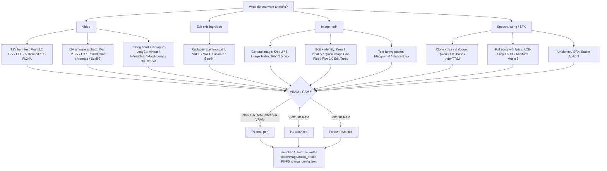
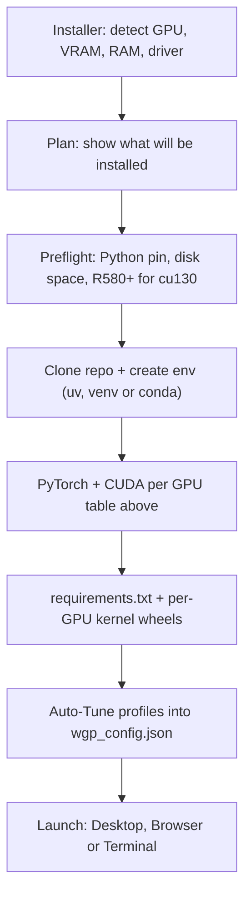
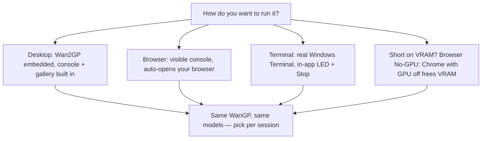
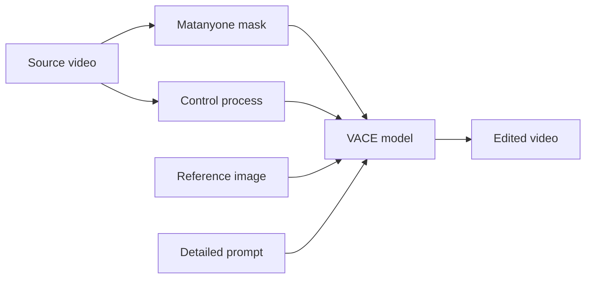
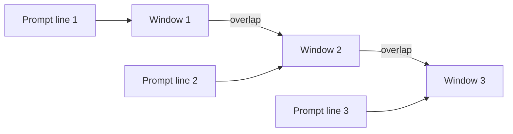
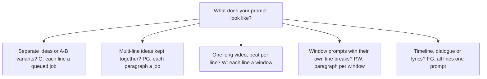
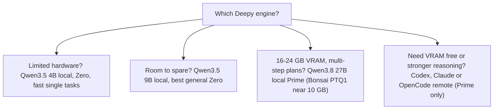
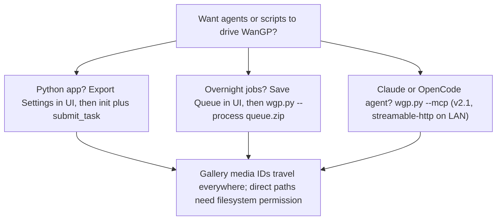
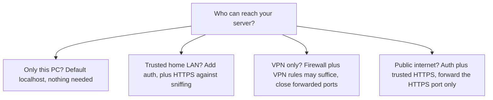
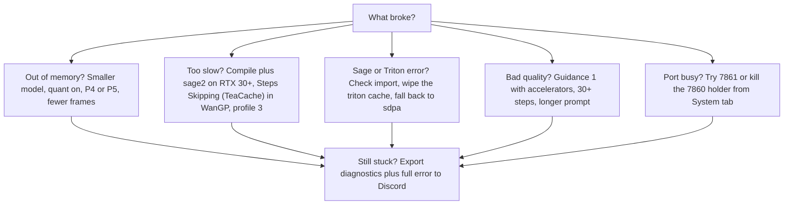

# WanGP Guidance — what to pick, and where to click (launcher vs WanGP)

Companion to `USER-GUIDE.md` (launcher screens/buttons). This guide answers
the *WanGP-side* question: which model, profile, LoRA, prompt mode and
post-processor for your goal — and whether you set it in the **launcher** or
in **WanGP's web UI**. Diagrams are Mermaid (renders on GitHub), choices are tables.

Upstream truth: model selector in WanGP, `defaults/*.json`, `profiles/*/*.json`,
`shared/cli_args.py`, `wgp_config.json`. Launcher never edits your WanGP checkout.

## Contents

- [Start here: goal -> model -> profile](#start-here-goal---model---profile)
- [Install prerequisites](#install-prerequisites-what-the-launcher-sets-up-for-you)
- [Guided paths](#guided-paths)
- [Launcher vs WanGP settings map](#launcher-vs-wangp-settings-map)
- [Models reference](#models-reference--inventory-by-family-282-defaultsjson-at-wangp-1883)
- [Generation settings reference](#generation-settings-reference)
- [LoRAs + accelerator profiles](#loras--accelerator-profiles)
- [Prompts + sliding windows](#prompts--sliding-windows)
- [Post-processing + DLSS5](#post-processing-upscale--audio)
- [Deepy + Prompt Enhancer](#deepy--prompt-enhancer)
- [Workspaces + sessions](#workspaces--sessions)
- [Plugins](#plugins-from-pluginsmd)
- [API + MCP](#api--mcp-for-agents-from-apimd)
- [Network protection](#network-protection-from-authenticationmd)
- [Launch flags (CLI) reference](#launch-flags-cli-reference)
- [Troubleshooting fast lane](#troubleshooting-fast-lane)

---

## Start here: goal -> model -> profile

Rules that save hours:

1. Start with the **distilled / Turbo / Lightning** variant, short clip first.
2. Auto-Tune in launcher (`Manage -> Auto-Tune`), then only change one thing at a time in WanGP.
3. Quantized ckpts (`int8`/`fp8`/`GGUF`/`NVFP4`/`Nunchaku`) keep workflow, cut memory. Pick in WanGP Configuration, or let Auto-Tune set `transformer_quantization`.
4. Long video = sliding windows + overlap, not one giant window (see below).

---

## Install prerequisites (what the launcher sets up for you)

From `INSTALLATION.md` — the launcher automates all of this; listed so you know why each step exists:

| Stack | RTX 20–50 | GTX 10/16 | AMD RDNA 2/3/3.5/4 | Intel/Apple |
| --- | --- | --- | --- | --- |
| Python | 3.11.14 | 3.10.9 | 3.12.10 | — |
| PyTorch | 2.10.0 + CUDA 13.0/13.1 (cu130, needs R580+ driver) | 2.7.1 + CUDA 12.8 (no R580 needed) | 2.13.0 ROCm 10 TheRock (stable whl-next, per-box device-gfx targets) | CPU / MPS (SDPA only) |
| Triton | `triton-windows>=3.7.0.post26,<=3.7.1.post27` (torch 2.10, recommended since v18.18 — ships WanGP's prebuilt CUDA helper, no JIT helper compile, no antivirus exclusion needed on these builds); `>=3.6,<3.7` legacy (torch 2.10, launcher Repair/roll-back target); `>=3.3,<3.4` (torch 2.7); `>=3.2,<3.3` (RTX 20XX) | — | `triton-windows>=3.7.0.post26,<=3.7.1.post27` (torch 2.13; prebuilt HIP helper, experimental) | — |
| Attention | Sage 2.2.0 (RTX 30+, Ampere+) / Sage 1.0.6 (RTX 20) / Flash 2.8.3 / Sparge 0.1.0 | SDPA | SDPA (default, AOTriton on RDNA3+) / Sage 1.0.6 / Flash 2.8.4 (ROCm/Triton) | SDPA |
| Quant kernels | Nunchaku 1.2.1, GGUF CUDA 1.0.29 (packed MMVQ/MMQ, direct FP16/BF16 activation quantization, CUDA-graph-safe workspaces, quantized KV-cache attention; single-launch row loop — 2–10% faster decode, less VRAM; packed rows crossing quant blocks — fixes MiniMax H3 image-reference projections), LightX2V 0.0.2 (RTX 50/sm120+ only), bitsandbytes 0.49.2 (optional, manual), Comfy Kitchen via requirements, WGPKernels 1.4.2 (in setup_config: RTX 20XX+/RDNA4, recommended) | — | Kitchen HIP (RDNA 3/3.5/4; RDNA2 falls back); HIP GGUF 1.0.29 wheel (in-env ROCm 10, RDNA4 opt-in, version-only bump — keeps the previous kernels, the single-kernel row loop is CUDA-only) | — |

Avoid PyTorch 2.8.0 (RAM leak on model switch) and 2.9.0 (VAE VRAM blowup).
`int8_kernels`: Auto tries WGPKernels → Kitchen CUDA/HIP → Triton → PyTorch
(upstream calls WGPKernels "recommended, second fastest, precise" and Kitchen
"fastest, least precise" — backends differ slightly at identical seed, so
garbage output means trying Triton/PyTorch explicitly);
`fp8_kernels` (Auto / CUDA / Triton / PyTorch) picks the same kind of kernel for
FP8 checkpoints; `kernel_precision` fast/strict controls H3 VAE fusions.
**v18.21 widens WanGP's own Triton kernels** instead of whitelisting the cards
they were first timed on: `shared/kernels/dispatch.py` now gates them by what the
arithmetic needs — BF16 from compute capability 8.0 (RTX 30+), FP16/FP32 from 7.5
(RTX 20 / GTX 16xx) — and Triton compiles each kernel for the card it runs on. It
only lands where the environment has Triton, i.e. RTX 20+ here: the GTX 10xx/16xx
profile installs no Triton (and SM 6.1 is below every floor anyway). This changes
no wheel, pin or setting: the kernel wheels above are unaffected and eligibility is
still checked before launch. Upstream measures the release itself as "many image,
video, 3D, speech and music models up to 10% faster with slightly less VRAM"
(README, v18.21). On RTX 20 the same release lifts two Sage 1 limits: masked calls
(inpainting, VACE masks) now run on WanGP's Turing kernel instead of falling back to
SDPA, and BF16 q/k/v are read as bits for sequences up to 2,048 tokens instead of
being copied to FP16 first (`shared/sage1_core.py`).
WGPKernels 1.4.2 is in `setup_config.json` (the Windows and Linux install
scripts include WGPKernels for RTX 20XX, 30XX, 40XX and 50XX; upstream labels it
"WGPKernels 1.4.2 (CUDA 13, RTX 20XX+)", "(CUDA 12.8, RTX 20XX+)" and
"(ROCm 10, RDNA4, experimental)", the `RTX_20` GPU profile now lists
`wgpkernels` and every other NVIDIA/AMD profile is unchanged) — WanGP checks the
kernels on your GPU before using them; install/update it from
**GPU Kernel Wheels → WGPKernels (INT8)** or
**↻ Update GPU Wheels** (after a WanGP update, re-run Sync: upstream's
*Update* only refreshes code and requirements, new pinned wheels arrive via
Sync); Auto prefers it once present.
On AMD, RDNA4 (RX 9060/9060 XT gfx1200 + RX 9070/9070 XT/R9700 gfx1201) uses
the experimental `rocm100` build, which loads in the installer's torch
2.13+rocm10 env — no separate env. The HIP GGUF wheel (1.0.29,
`torch213rocm100py312`) is built for that same env and *↻ Update GPU Wheels*
installs it automatically on RDNA4. RDNA 1–3.5 cards have no WGPKernels/HIP
wheel. GGUF 1.0.28 added a speedup for RTX 20 language models: Bonsai and other PTQ1_0
models decode their tokens and speculative drafts faster because each block of
weights is decoded once for all the tokens of a step.

Every kernel wheel is downloaded over TLS, hashed and checked **before** pip
runs. The launcher pins the SHA-256 of the exact assets above (trust on first
use: a re-uploaded wheel under the same version fails loudly) and falls back to
GitHub's published digest for anything newer, so a version bump still verifies;
when neither is available it warns and records the hash it saw. A mismatch
aborts that component and nothing is installed. Verified wheels are kept in
**`<data folder>\wheel-cache`** (e.g. `C:\Wan2GP\wheel-cache`) so a re-sync
re-hashes a local file instead of re-downloading 150 MB — the folder is a cache
and safe to delete.

Pinokio installs are detected and left
untouched — the launcher can reuse their model library instead of re-downloading.

## Guided paths

### Path 1 — first video (5 min)

| Step | Where | What |
| --- | --- | --- |
| 1 | Launcher Dashboard | Install, then Auto-Tune, then **Desktop** launch |
| 2 | WanGP model dropdown | `Wan 2.1 T2V 1.3B` or `Wan 2.2 T2V` distilled |
| 3 | Prompt | `A cat walking in a garden, cinematic, soft light` |
| 4 | Settings | 49 frames (~2s), 20 steps, guidance ~5 |
| 5 | Generate | Keep seed if you like it, vary prompt next |

If out-of-memory: smaller model -> fewer frames -> lower resolution -> P5 profile. Exact fallback: `--attention sdpa --profile 4`.

### Path 2 — animate a photo (i2v)

Image goes in **Start Image**. Prompt describes **motion/camera**, not the
subject (already in the image): `she smiles, turns toward the window, camera
pushes in`. Try several motions via queue mode `G` (one line = one job).
Starter pick ★ `minimax_h3_fasth3_omni` — 8-step FastVideo-distilled video +
synced audio from text and ordered image/video/audio references (124 frames,
8 steps, guidance 1); distilled with references, so give it at least one image
or video reference — the NVFP4 variant is 13 GB and fastest on RTX 50xx.
For the FL2VA path, 18.888 adds the **Pika H3 Flex FL2VA 6 Steps** profile:
pick it in the toolbar instead of setting steps by hand (6 steps, guidance 1,
`flow_shift 12`, `pika_renoise` sampler; the Pika LoRA downloads on first use).
For stills instead of motion, ★ `fibo2_dev` is the launcher's image starter:
unified text-to-image plus reference and masked editing from plain-language or
structured captions (0 frames, 50 steps, guidance 5) — Fibo 2.0 Edit Turbo does
4-step instruction edits instead.

### Path 3 — talking head / dialogue

Models: `InfiniteTalk` (long dialogue, sliding windows), `LongCat Avatar`,
`H3 Ref2VA` (reference-driven). Prompt = scene + mood; **audio input** carries
voice identity. Use `Speaker 1:` / `Speaker 2:` script format with
`All lines are part of same prompt` (`FG`) so dialogue isn't split into jobs.

### Path 4 — song / speech

Lyrics stay together (`FG` mode). `ACE-Step 1.5 XL` for lyric-faithful songs,
`Qwen3 TTS Base` for flexible cloning baseline, `IndexTTS2` for emotional
two-speaker dialogue. Style tags go in the alt/extra field, not scattered lines.

### Path 5 — edit / replace (VACE)

1. Control Video = original clip, pick Process (`Transfer pose`/`Depth`/
   `Inpainting`/`Keep Unchanged`) + Area (`whole`/`masked`/`non-masked`).
2. Build Video Mask in Matanyone (mask generator), export to Control + Mask inputs.
3. Reference Image = who/what to inject; describe them explicitly in prompt.
4. Grey `127` = replace with prompt/refs; pose wireframe = animate a person.
5. Enable Skip Layer Guidance for CFG VACE (not for Fusionix/CausVid no-CFG),
   15 steps min, 30+ best.
6. Still images (no video path needed): ★ `fibo2_edit_turbo` does four-step
   instruction editing with 1–4 references or a masked source image — editing
   only, no CFG, so keep guidance 1 and supply the references (or the mask) the
   instruction is about.

### Path 6 — long video (sliding windows)

* Plan-all-windows-at-once = best quality (one merge/encode), needs decided prompts upfront.
* Continue-video repeatedly = improvisation, slight re-encode loss each hop.
* End Images per window + `[/overlap=9]` / `[/new_shot]` / `[/duration=5s]` control joins.
* Test one short window first. Keep overlap moderate; discard weak tail frames if ends blur.

### Path 7 — polish (upscale / soundtrack)

Don't regenerate a good scene — late-postprocess it: spatial upscale
(`lanczos*2`, `vae*2`, DLSS5), temporal interp (`rife*2`), soundtrack
(`mmaudio`), voice swap (`seedvc_*`). Originals stay untouched.

---

## Launcher vs WanGP settings map

| Goal | Set in launcher | Set in WanGP UI |
| --- | --- | --- |
| Install / env / kernels / paths | Dashboard + Installer + GPU Wheels + Active Env | — |
| VRAM/RAM profile P0-P5, quant, attention | Auto-Tune writes `video/image/audio_profile`, `transformer_quantization`, `int8_kernels`, `kernel_precision`, `vae_config` | Fine-tune per task via `overrides` |
| Model choice | — (update/sync only) | Model dropdown + toolbar search; finetune `+` tool |
| Prompt + steps/frames/guidance/seed | — | Generation form per model |
| LoRAs + multipliers, `.lset` | — (folders under `loras_root`) | Advanced -> Loras tab, `activated_loras` + `loras_multipliers` |
| Accelerator preset | — | Settings dropdown -> Apply (e.g. `Lightning t2v * Steps`, `FusioniX t2v - 10 Steps`) |
| Control/mask/reference/sliding windows | — | Generation form + Matanyone + `[/...]` prompt commands |
| Upscale/audio post | DLSS5 installer card | Post Processing section + Late Post Processing tab |
| Deepy engine/quant/VRAM/context/sessions | Deepy + Prompt-enhancement + Deepy Web cards write same `wgp_config.json` | Configuration -> Prompt Enhancer / Deepy; Ask Deepy -> Settings |
| Plugins | Manage -> Plugins (catalog + favs) | Plugins tab (enable, per-plugin UI) |
| Workspaces/gallery | Gallery viewer (select/reorder/ZIP/import/eject/delete) | Gallery + workspace selector + magnifier manager |
| Server/ports/auth | Manage -> Launch + Deepy Web auth/port | `--listen/--auth/--public-url` equivalents |
| Updates/verify/rollback | Dashboard action row + Manage -> System | — |

Rule: launcher owns **install, env, kernels, profiles, launch, update, backup**.
WanGP owns **model, prompt, generation, LoRA pick, control, post**.

---

## Models reference — inventory by family (289 `defaults/*.json` at WanGP 18.888)

Reconciled live against upstream `defaults/` (289 files + `ReadMe.txt`, WanGP v18.888);
the 18.21 pass counted 276, and the families below list the variants that change
the pick rather than every sibling id. The 18.888 pass adds only the two H3
**Singularity V2** Ref2VA defaults (full 33B + pruned 20B) and the **Pika H3 Flex**
6-step accelerator profiles, so the 18.88 inventory below still stands. The 18.88
pass is the 3D redesign: TRELLIS.2
and Hunyuan3D 2.1 became **shape** models with Texturer presets (`trellis2_shape`,
`trellis2_texture`, `hunyuan3d_21_shape`, `hunyuan3d_21_paint`), joined by Pixal3D
and the SUPRA-Tex Texturer and Hi3D Refiner, while the Waypoint world handler was
removed (`hy_nomas` is the world model); it also adds `flux2_klein_9b_kv` and
`profiles/` preset folders for the 3D stage models. The 18.21 commits were kernel and
model-internals work plus the new **FlashVSR+ Turbo**
extension model, which is a `postprocessing/` handler and not a `model_type`; the
v18.20 reconciliation added Fibo 2.0 Dev, Fibo 2.0 Edit Turbo and the two MiniMax
H3 FastH3 Omni presets; v18.19 added MOSS-TTS v1.5 (8B + Local 4B) and
named the Krea 2 Edit v2 ids; the v18.18 reconciliation added the 3D-gen wave,
Kandinsky 6, Wan 2.2 Prism, camera control, H3 Veda, MOSS Image, Ming Image and
the v2 Krea edit presets).
Every id below is
a selectable `model_type`. Starred = guided-path starter; rest = same workflows,
different speed/memory/quality trade (distilled/Turbo/Lightning/PDD/NVFP4/GGUF/
Nunchaku/pruned variants). Full catalogue truth = WanGP model selector + toolbar search.

### Video — Wan

| Architecture ids | Model_type ids |
| --- | --- |
| `t2v`, `t2v_1.3B`, `t2v_1.3B_nvfp4`, `t2v_sf`, `t2v_fusionix`, `t2v_nexus_1.3B` | ★ `t2v` (Wan 2.1 14B T2V), 1.3B fast/low-VRAM, NVFP4, Self-Forcing, FusioniX, Nexus |
| `i2v`, `i2v_720p`, `i2v_nvfp4`, `i2v_fusionix` | ★ `i2v` (Wan 2.1 I2V 480p/720p), NVFP4, FusioniX |
| `fun_inp`, `fun_inp_1.3B` | Fun InP 1.3B (fast animate) / 14B |
| `fun_camera_1.3B`, `uni3c` | Wan 2.1 Camera Control: animates a start image while the camera follows a chosen 3D path — Fun Control-Camera (preset moves or custom path), Uni3C 14B (image lifted to a point cloud, rendered along the path) |
| `prism` | Wan 2.2 Prism Alpha 14B: image-to-video with jointly generated audio (MOVA two video experts + audio transformer), natively up to 2K |
| `t2v_2_2` ★, `ti2v_2_2`, `ti2v_2_2_fastwan` | ★ `t2v_2_2` (Wan 2.2 14B general), TI2V 5B unified, FastWan |
| `i2v_2_2` ★, `i2v_2_2_Enhanced_Lightning_v2`, `..._svi2pro`, `i2v_2_2_Enhanced_Lightning_v2_svi2pro`, `i2v_2_2_multitalk`, `i2v_2_2_svi2pro` | ★ `i2v_2_2`, Lightning v2 (timeline prompts), svi2pro (better prompt comprehension + camera handling), multitalk |
| `flf2v_720p` | First/last-frame bridge (storyboard: Qwen stills -> Wan motion) |
| `shotplan_t2v`, `shotplan_t2v_2_2` | Shotplan multi-shot reuse |
| `vace_1.3B`, `vace_14B` ★, `vace_14B_2_2`, `vace_14B_sf`, `vace_14B_fusionix` ★, `vace_14B_cocktail`, `vace_14B_cocktail_2_2`, `vace_14B_lightning_3p_2_2`, `vace_fun_14B_2_2`, `vace_fun_14B_cocktail_2_2`, `vace_standin_14B`, `vace_multitalk_14B`, `vace_lynx_14B`, `vace_ditto_14B` | ★ `vace_14B` + Fusionix (accelerated default); 1.3B lean; cocktail/lightning/SF accelerators; Fun/Standin/MultiTalk/Lynx/Ditto composites |
| `animate`, `animate2`, `animate2_distilled` ★ | ★ `animate2` (Wan 2.2 Animate motion transfer), Animate 2 distilled/cache |
| `scail`, `scail2_14B` ★, `steadydancer`, `standin`, `viggle_animate` | ★ `scail2_14B` (multi-person animate/replace, sliding windows); Viggle 3-step H3-based |
| `lynx` ★ | ★ `lynx` identity-preserving face replacement |
| `multitalk`, `multitalk_720p`, `infinitetalk` ★, `infinitetalk_multi` | ★ `infinitetalk` (long dialogue, sliding windows); MultiTalk 1-2 speakers |
| `vista4d`, `vista4d_720p` | Reshoot dynamic scene, new camera path |
| `wanmove`, `moviigen`, `mocha`, `fantasy` | Motion/character specialists, legacy Fantasy |
| `phantom_1.3B`, `phantom_14B`, `recam_1.3B` | Phantom, Recam legacy |
| `sky_df_1.3B`, `sky_df_14B`, `sky_df_720p_14B` | SkyReels Diffusion Forcing |
| `alpha`, `alpha_sf`, `alpha2`, `alpha2_sf` | Wan Alpha (transparent PNG-frame ZIP via side_files) |
| `hunyuan`, `hunyuan_t2v_fast`, `hunyuan_t2v_accvideo` | HunyuanVideo T2V + fast/accvideo |
| `hunyuan_i2v`, `hunyuan_avatar`, `hunyuan_custom`, `hunyuan_custom_audio`, `hunyuan_custom_edit` | I2V, avatar (audio-driven), custom-audio (speak/sing from ref), edit |
| `hunyuan_1_5_t2v` ★, `hunyuan_1_5_480_t2v`, `hunyuan_1_5_480_t2v_lightx2v`, `hunyuan_1_5_i2v`, `hunyuan_1_5_480_i2v`, `hunyuan_1_5_480_i2v_step_distilled`, `hunyuan_1_5_upsampler`, `hunyuan_1_5_upsampler_1080` | ★ 8.3B T2V/I2V + distilled/lightx2v + upsamplers |

### Video — LTX / H3 / others

| Architecture ids | Model_type ids |
| --- | --- |
| `ltxv_13B`, `ltxv_distilled` | LTX-Video 13B legacy |
| `ltx2_19B`, `ltx2_19B_nvfp4`, `ltx2_distilled` (+`_gguf_q4_k_m/_q6_k/_q8_0`) | LTX-2 19B, distilled, GGUF/NVFP4 |
| `ltx2_22B` ★, `ltx2_22B_1_1`, `ltx2_22B_distilled` ★, `ltx2_22B_distilled_1_1` ★, `ltx2_22B_nvfp4`, `ltx2_22B_msr`, `ltx2_22B_msr_v2`, `ltx2_22B_edit_anything` (+distilled/edit variants, GGUF) | ★ `ltx2_22B_distilled_1_1` fast general; Dev for control; MSR/MSR-v2 2-5 refs; Ingredients; edit-anything |
| `ltx2_25_22B`, `ltx2_25_22B_distilled` ★, `ltx2_25_22B_distilled_nvfp4`, `ltx2_25_22B_msr`, `ltx2_25_22B_alpha_gen`, `ltx2_25_22B_layout_to_render` | ★ 2.5 Distilled (native audio-video, IC-LoRA, Ingredients, unblur/uncompress); Alpha Gen (soft alpha matte from any video, optional selection mask → transparent PNG frames ZIP / ProRes 4444); Layout to Render (playblast + appearance ref → finished shot) |
| `joyai_echo`, `joyai_echo_surgical` ★ | ★ Surgical: connected multi-shot stories, reusable memories (`[/store_mem]`/`[/load_mem]`/`[/drop_mem]`) |
| `minimax_h3_fl2va` ★, `..._pruned` ★, `..._pdd`, `..._pruned_pdd`, `..._veda`, `..._pruned_veda` | ★ `minimax_h3_fl2va_pruned` (video+soundtrack, start/end, inject `KFI`+`frames_positions`, control, outpaint, 2-phase+tiling, Spectrum/First-Block-Cache, Sol-Attn); `_veda` variants use learned sparse attention (up to 2× faster at high res/longer videos, same settings+LoRAs); `_pdd` variants are locked to 8 steps + Euler with two-phase off and **accept base-model LoRAs** — their output-layer change reaches every PDD head. 18.888 adds the **Pika H3 Flex FL2VA 6 Steps** profile (6 steps, guidance 1, `flow_shift 12`, `pika_renoise`, Pika LoRA auto-download; upstream reports better aesthetics, anatomy, prompt following and audio than vanilla H3's 50-step run) |
| `minimax_h3_singularity_v2`, `..._pruned` | **Singularity V2** Ref2VA fine-tune (18.888), full 33B / pruned 20B: clearer fast action, sharper distant faces and less glossy skin than vanilla H3; V2 focuses combat, fantasy effects and stronger prompt/style control. Same Ref2VA inputs as the base model |
| `minimax_h3_control`, `..._pruned` | ControlNet-Union 2.0 branch on FL2VA (33B / pruned 20B): pose, depth, edge, shape and recoloring controls, plus inpainting and spatial outpainting |
| `minimax_h3_ref2va`, `..._pruned` ★, `..._pdd`, `..._pruned_pdd`, `..._veda`, `..._pruned_veda` | ★ pruned (refs guide result, ref pixel budget 50-400%, persists across windows); `_veda` = Veda sparse attention; `_pdd` = 8 steps + Euler, two-phase off, base-model LoRAs apply (all PDD heads) |
| `minimax_h3_ref2va_pruned` (FastH3 Omni) | ★ `minimax_h3_fasth3_omni` — MiniMax H3 FastH3 Omni 8-Step 20B: FastVideo distillation + sparse video attention (VSA), 8 steps, `guidance_phases 1` (no CFG), `flow_shift 12`, `video_prompt_type "I"`; same Ref2VA inputs (ordered images/videos/audio clips, start/end images, frame injection, reference or control video, soundtracks, continuation), faster than Ref2VA PDD at the same VRAM, distilled with references so best with ≥1 image/video reference; `minimax_h3_fasth3_omni_nvfp4` — MiniMax H3 FastH3 Omni NVFP4 QAD 8-Step 20B: same settings, 13 GB (smallest FastH3 Omni, lowest VRAM), NVFP4 weights trained for 4-bit inference, fastest on RTX 50xx FP4 tensor cores, slower on RTX 30xx/40xx |
| `minimax_h3_vdn`, `..._pruned`, `minimax_h3_tts_ref2va_pruned` | VDN 20%+ faster; TTS preset (hidden 32x32 video, 32 kHz audio only) |
| `k6_pro_distill`, `k6_lite_distill` | Kandinsky 6: 5s video with synchronized soundtrack (speech with lip-sync, music, sound effects) from text or a start image; Pro 30B / Lite 3B, both distilled (10 steps), low-VRAM with a faster in-house VAE |
| `k5_lite_t2v` (+`_10s_distil`, `..._sparse`, `_5s_distil`), `k5_lite_i2v`, `k5_pro_t2v` (+`_10s_sft`, `..._sparse`), `k5_pro_i2v` | Kandinsky 5 Pro/Lite, camera-motion control |
| `longcat_video`, `longcat_avatar`, `longcat_avatar_multi`, `longcat_avatar_v1_5` ★ | ★ v1.5 distilled audio-driven avatar, sliding windows |
| `ovi`, `ovi_fastwan`, `ovi_1_1` ★, `ovi_1_1_10s`, `ovi_1_1_fastwan`, `ovi_1_1_10s_fastwan` | ★ Ovi 1.1 video + synced soundtrack, speaking characters |
| `magi_human`, `magi_human_distill` ★, `magi_human_sr1080`, `magi_human_distill_sr1080` | ★ distill talking-head, staged hi-res |
| `bernini`, `bernini_1.3B` | V2V + multi-ref edit (1.3B lean) |

### Image

| Architecture ids | Model_type ids |
| --- | --- |
| `flux`, `flux_schnell`, `flux_chroma`, `flux_chroma_radiance`, `flux_krea`, `flux_srpo`, `flux_srpo_uso`, `flux_dev_kontext` ★, `flux_dev_kontext_dreamomni2`, `flux_dev_umo`, `flux_dev_uso` | Schnell/Dev/Kontext (instruction edit)/Krea/Chroma/SRPO/USO |
| `flux2_dev`, `flux2_dev_nvfp4`, `flux2_klein_4b`, `flux2_klein_9b`, `flux2_klein_9b_kv`, `flux2_klein_base_4b`, `flux2_klein_base_9b`, `pi_flux2`, `pi_flux2_nvfp4` | Flux 2 Dev + Klein 4B/9B (distilled, four steps) and Base (non-distilled, more diverse); `flux2_klein_9b_kv` (v18.88) reuses reference information so multi-image edits run faster — text-only generation gains nothing from it; `pi_flux2` (pi-FLUX.2 Dev 32B) is FLUX.2-dev distilled to four steps with the pi-Flow method (Gaussian-mixture velocity field, shares the `flux2_dev` weights + a 4-step LoRA) |
| `flux3_klein` ★, `flux3_klein_base`, `flux3_klein_nvfp4`, `flux3_klein_base_nvfp4` | ★ Flux 3 Klein 5.6B distilled (16 steps, no CFG) + Base (50 steps, CFG); up to 10 ordered references; NVFP4 variants |
| `fibo2_dev` ★ | ★ Fibo 2.0 Dev (Bria AI): unified text-to-image plus reference and masked editing from plain-language or structured Fibo captions; 1024x1024, 50 steps, guidance 5.0, bf16 + int8_convrot |
| `fibo2_edit_turbo` ★ | ★ Fibo 2.0 Edit Turbo: four-step instruction editing with 1–4 references or a masked source image; editing only, no CFG (guidance 1.0), 1024x1024, `video_prompt_type "KI"` (needs a reference) |
| `qwen_image_20B` ★, `qwen_image_21_7B` ★, `qwen_image_21_turbo_7B`, `qwen_image_2512_20B`, `qwen_image_edit_20B`, `qwen_image_edit_plus_20B` ★, `qwen_image_edit_plus2_20B`, `qwen_image_edit_plus_20B_nunchaku_r128_fp4/int4`, `qwen_image_layered_20B` | ★ base/edit-plus (multi-subject, long text); 2.1 new; 2.1 Turbo 7B (8-step distilled, Turbo scheduler at guidance 1, no acceleration LoRA); layered; Nunchaku quant |
| `z_image` ★, `z_image_base`, `z_image_control`, `z_image_control2`, `z_image_control2_1`, `z_image_control2_1_8s`, `z_image_twinflow_turbo`, `z_image_nunchaku_r128_fp4/r256_int4` | ★ Turbo 6B fast; Control/Control2.x edit; TwinFlow; Nunchaku |
| `krea2_raw` ★, `krea2_turbo` ★, `krea2_raw_edit`, `krea2_turbo_edit`, `krea2_turbo_general_edit_v2`, `krea2_turbo_identity_edit_v2` (+ per-model `general`/`identity` **v2** full-rank edit LoRAs) | ★ RAW (CFG) / Turbo (distilled); Edit presets: General (recolor, relight, backgrounds, objects, text, restyle), Identity (2 refs + scene/pose/outfit restaging with likeness preserved; LanPaint inpaint/outpaint, NAG negatives); the named `_v2` ids are the 8-step General/Identity Edit v2 models |
| `moss_image`, `moss_image_sft` | MOSS Image 5B (OpenMOSS): text-to-image from plain language, tags or the Prompt Helper layout editor (boxes guide composition, not exact pixel masks); optional layout enhancer follows the selected canvas; Base & SFT (curated-data post-training), 50 steps CFG |
| `ming_image_0_1_design`, `ming_image_0_1_design_layer` | Ming Image 0.1 Design 6B: text-rich designs/infographics/posters (text or structured JSON prompt, Prompt Helper layer arrangement, optional RGBA output, classic/JSON enhancers); Design-Layer splits a flattened design into transparent layers (each added to the gallery + a ZIP of the full set) |
| `ideogram4` ★, `ideogram4_nf4`, `ideogram4_turbotime` | ★ typography/layout/JSON prompt (+Magic Prompt + visual helper); Turbo 4-8 steps |
| `hidream_o1`, `hidream_o1_dev`, `hidream_o1_dev_2604` | HiDream text/ref + control |
| `sensenova_u1_5_8b_mot` ★ | ★ native-4K infographics, Infographic Prompt enhancer, 8-step LoRA profile |
| `kiwi_edit`, `kiwi_edit_instruct_only`, `kiwi_edit_reference_only`, `lucy_edit`, `lucy_edit_1_1`, `lucy_edit_fastwan`, `lucy_edit_fastwan_1_1` | Instruction/reference edit variants |

### 3D / world reconstruction

The model selector starts with the goal — **Create** (`image_to_3d`), **Texture**
(`texture_mesh`), **Refine** (`refine_mesh`), **Split** (`mesh_parts`), **Animate**
(`animate_mesh`), **Reconstruct** (`recon3d`) — then lists that goal's models.

| Architecture ids | Model_type ids |
| --- | --- |
| `trellis2_shape` ★ | ★ TRELLIS.2 Shape 4B (Microsoft): one image → untextured GLB that keeps thin, intricate structures (sparse-voxel + mesh decode); presets add a Texturer in the same run — `SUPRA-Tex PBR`, `Hunyuan3D 2.1 Paint PBR`, `TRELLIS.2 Texture PBR` |
| `trellis2_texture` | TRELLIS.2 Texture 2.6B: several times faster than the other Texturers; plausible materials whose colours only approximate the picture and change with the seed (no print/patterns) |
| `hunyuan3d_21_shape` ★ | ★ Hunyuan3D 2.1 Shape 3B: one object photo → untextured GLB; preset `Hunyuan3D 2.1 Paint PBR` adds PBR textures (base colour + metallic-roughness) in the same generation |
| `hunyuan3d_21_paint` | Hunyuan3D 2.1 Paint 2B: paints **all around** a mesh you supply from generated views — the tolerant choice when the picture and the mesh differ (fine print blurs) |
| `pixal3d` | Pixal3D Shape 3x1.3B: builds the mesh in the picture's own camera, so it fits the image exactly; preset `SUPRA-Tex PBR` textures it |
| `supratex_texture` | SUPRA-Tex Texturer 2.1B: PBR textures that keep the picture's colours, print and patterns on the visible side, the hidden side completed to match. The picture must line up with the mesh; its material stage reuses Qwen Image 2.1 — **non-commercial use only** (Qwen Research License) |
| `hi3d` | Hi3D v1.0 Mesh Refiner 2x1.8B: refines a coarse mesh into high-resolution geometry (seams, buttons, scales, engravings) from a picture of the same object; `512` quick, `1024` strong detail, `1536` finest for ~2× the time. Keeps position/scale, **drops textures** |
| `triposg` | TripoSG (VAST, 1.5B): one image → detailed mesh (GLB, geometry only); presets pair it with the 3D Refiner and Texturers |
| `triposplat` | TripoSplat: one image → Gaussian splats (PLY, up to 262K Gaussians) |
| `partcrafter` | PartCrafter (built on TripoSG): one image → one mesh per part (GLB, one coloured node per part) |
| `worldmirror_2` | WorldMirror 2.0 1.2B (Tencent): several photos or a video → static 3D scene (Gaussian splats or point cloud) with estimated cameras, in one pass |
| `mapanything` | MapAnything (Meta): several photos or video frames → merged metric point cloud shown as splats, with every camera pose |
| `da3_points` | Depth Anything 3 (the checkpoint behind WanGP's depth preprocessor): photos or video frames → merged point cloud scene |
| `moge2` | MoGe-2 (Microsoft): one photo → visible geometry in metres (splats or textured mesh, normals + camera FOV) |
| `geosam2` | GeoSAM2 (VAST): splits an existing mesh into its parts, automatically or from point prompts on rendered views (one GLB node per part) |
| `animate_any_mesh` | AnimateAnyMesh: animates a static 3D mesh from a text motion description (16 frames of vertex trajectories, no rig) |

**3D post-processing** (Post Processing tab of every untextured shape model —
Hunyuan3D Shape, TripoSG, TRELLIS.2 Shape, Pixal3D, Hi3D) runs two steps on each
generated mesh with the generation's object image: a **3D Refiner** (`hi3d_refiner`,
geometry first) and a **Texturer** (`supratex`, `hunyuan3d_paint`, `trellis2_texture`).
Presets combine them (`SUPRA-Tex PBR`, `Hi3D + SUPRA-Tex PBR`, …). Rules upstream
enforces: a model that already textures its meshes takes no Texturer, and a textured
mesh cannot be refined (refining replaces the geometry and drops its textures).
Late post-processing takes a mesh from the gallery plus its **Object Image**
(`postprocessing_reference_images`, one field used by both steps); with **Embed
Source Images** on, new 3D assets keep the object image inside the GLB.

Requirements and licences: one whole uncropped object on a plain or transparent
background, three-quarter view, even light; backgrounds are removed automatically
with BiRefNet (~1 GB one-time download — `rembg`, Windows/Linux only). Hidden sides
are inferred. SUPRA-Tex's material stage is non-commercial (Qwen Image 2.1).

3D assets open in the **3D gallery**: rotate, zoom, save any view at the resolution
you want and reuse it as a start image; compatible meshes become inputs of the
Texture/Refine/Split/Animate goals with **To Input Mesh**, or of generated
images/videos sent to 3D.

### Audio / TTS / music

| Architecture ids | Model_type ids |
| --- | --- |
| `moss_tts_v1_5` ★, `moss_tts_local_v1_5` | MOSS-TTS v1.5 (OpenMOSS): 8B (★) and Local 4B multilingual speech with cloning of up to three voices, dialogue with adjustable pauses, optional script writing (Local 4B outputs 48 kHz stereo); BF16 / INT8 ConvRot; LM decode is automatic — CUDA Graphs with every profile |
| `qwen3_tts_base` ★, `qwen3_tts_customvoice`, `qwen3_tts_voicedesign` | ★ Base (clone + 2-speaker, low VRAM); Custom Voice; Voice Design |
| `index_tts2` ★, `index_tts25` | ★ expressive clone, tagged/auto emotion, long dialogue |
| `fish_drama3` ★, `fish_drama3_int4` | ★ Fish Audio Drama 3 expressive speech/dialogue (optional voice ref + exact transcript); INT4 Experts halves RAM/VRAM |
| `chatterbox` | Multilingual speech (Write Speech) |
| `kugelaudio_0_open` | Cloned dialogue |
| `omnivoice` | Multilingual + design + clone |
| `auk`, `auk_flash` | Instruction speech / source-record edits (Flash 4-step) |
| `ace_step_v1`, `ace_step_v1_5` (+`_turbo_lm_0_6b/1_7b/4b`), `ace_step_v1_5_xl` ★ (+turbo LM) | ★ XL lyrics-faithful songs |
| `minimax_music3` | 5-min 44.1 kHz stereo songs (automatic LM decode with CUDA Graphs, INT8 ConvRot) |
| `heartmula_oss_3b`, `heartmula_rl_oss_3b_20260123` | Songs + style tags |
| `stable_audio3_small` ★, `stable_audio3_medium`, `stable_audio3_small_sfx` | ★ music/loops/ambience/SFX |
| `scenema_audio`, `dramabox_audio` | LTX-audio scene speech/dialogue |
| `yue2`, `yue2_hum` | Lyrics+style songs (ABC/MIDI score via `custom_settings.save_score`, `.abc` in `custom_guide`) |
| `chrono_edit`, `chrono_edit_distill` | Video edit (strict format — enhancer text+image mode) |

Variant suffixes (`_distilled/_turbo/_pdd/_pruned/_nvfp4/_gguf_* /_nunchaku_*/_lightx2v/_fastwan/_sf/_fusionix/_cocktail/_sft/_sparse`) = same workflow, different speed/memory. Prefer recommended/distilled first.

---

## Generation settings reference

Essentials (names as in `docs/SETTINGS.md` / Export Settings JSON):

> Code notes: valid profiles are `0, 1, 2, 3, 3.5, 4, 4.5, 5` (upstream
> `docs/CLI.md`; upstream default `4`) — P0 = P4's part-by-part transfers with
> no permanent Reserved RAM, so each model's parts live in Reserved RAM only
> while it runs and the VRAM they leave free stays filled (Dynamic Preload);
> P1 max perf, P4 balanced default, P5 failsafe. The launcher's memory panel
> offers all eight; Auto-Tune recommends P0 wherever RAM is under 32 GB (the
> low-RAM fast path, since neither P4 nor P5 can afford their permanent
> reservation there), P1–P4 above that, and P5 only through *Prefer failsafe*
> (`src-tauri/src/features.rs`, the profile matrix). `vae_config` is
> `0=auto, 1=16GB+, 2=8GB+, 3=6GB+` — Auto defers tiling to runtime (Wan vs
> Qwen 2.1 tile presets + 16000/8000 MiB thresholds), so a fixed tier wastes
> VRAM or adds banding. `transformer_quantization`
> is `none/int8/fp8/nvfp4`; int8 is the recommended balance. `text_encoder_quantization`
> is `bf16` (16-bit, better quality, more RAM) or `int8` (8-bit, less RAM). `int8_kernels`
> (`auto/disabled/wgpkernels/triton/kitchen`) + `fp8_kernels` (`auto/pytorch/triton/cuda`)
> + `kernel_precision` (`fast/strict`) are the kernel settings (v18.11). Reserved RAM
> is `perc_reserved_mem_max`, a percentage 0–100 in `wgp_config.json`
> (`wgp.py`: `server_config.get("perc_reserved_mem_max", 0) / 100`); the CLI
> `--perc-reserved-mem-max` takes a fraction and wins when non-zero. `vram_safety_coefficient` default is
> now `0.85` (upstream `shared/cli_args.py`; `mmgp/README.md` says "0.85 by
> default") for >=12 GB VRAM — the launcher's own tighter tiers keep their
> values (`0.70` tight, `0.60` failsafe, failsafe forces P5). Upstream profile
> default when unset is `LowRAM_LowVRAM` (`wgp.py:_normalize_profile_defaults`),
> audio `3.5`.
> Audio rule: the LM decoder choice is gone — the Configuration plugin's
> "Language Models Decoder Engine" dropdown (`lm_decoder_engine`) was removed
> and the vLLM engine was replaced by the in-tree `lmgp` rewrite
> (`shared/llm_engines/lmgp/*`, `nanovllm` removed). LM acceleration is now
> automatic: CUDA Graphs with every profile, and on RTX 20 the language models
> of autoregressive models (speech, music, prompt enhancer) use WanGP's PyTorch
> kernels with CUDA Graphs automatically — so >=12 GB cards still use audio
> profile 3 even when video is P4
> (`src-tauri/src/features.rs` — audio rides P3 for P2/P4/P4.5, else inherits).

| Setting | Meaning | Starter |
| --- | --- | --- |
| `model_type` | Model id, e.g. `ltx2_22B_distilled` | via dropdown |
| `prompt` / `negative_prompt` | Scene / what to avoid | short + style words |
| `resolution` | `WIDTHxHEIGHT` | 720p first |
| `video_length` | Frames (25~1s, 49~2s); accepts `"10s"` with `force_fps` | 49 |
| `num_inference_steps` | Quality vs speed | 20 (8-10 w/ accelerator LoRA) |
| `guidance_scale` (+2/3) | Prompt adherence; accelerators want `1` | 4-7 |
| `seed` | `-1` random, fixed = reproducible | -1 then lock |
| `image_start/end/refs` | Start, end, reference/injected frames | per path above |
| `video_guide/mask`, `denoising/masking_strength` | Control + area | preview thumbnails first |
| `audio_guide/guide2` | Voice/soundtrack refs | per audio path |
| `overrides` | Per-task config replacements as `name=value` pairs, comma-separated (`attention_mode='sage2', memory_profile=4`) | empty = global config |
| `sliding_window_size/overlap` | Long-video chunking | test short first |

### Complete settings key list (119 keys, `models/_settings.json`, `settings_version` 2.82)

Model handlers show/hide per model; Export Settings JSON is the per-model truth.
Groups follow `docs/SETTINGS.md`; the post-processing inputs are the per-slot
parameter dictionaries of `postprocessing/parameter_ui.py` (settings 2.82 replaced
the old `spatial_upsampler_*` keys); `model_type`/`settings_version` are UI/export
labels, not stored keys:

* Model/identity: `client_id`, `model_mode`, `config`
* Prompt: `prompt`, `negative_prompt`, `alt_prompt`, `prompt_enhancer`, `multi_prompts_gen_type`, `multi_images_gen_type`, `custom_settings`
* Shape: `image_mode`, `resolution`, `batch_size`, `video_length`, `duration_seconds`, `pause_seconds`, `force_fps`, `repeat_generation`, `output_filename`
* Sampling: `seed`, `num_inference_steps`, `num_inference_steps2`, `custom_sigmas` (explicit sigma schedule; empty = the model's), `sample_solver`, `flow_shift`, `temperature`, `top_p`, `top_k`
* Guidance: `guidance_phases`, `model_switch_phase`, `switch_threshold`, `switch_threshold2`, `guidance_scale`, `guidance2_scale`, `guidance3_scale`, `audio_guidance_scale`, `embedded_guidance_scale`, `alt_guidance_scale`, `alt_scale`, `audio_scale`, `control_net_weight`, `control_net_weight2`, `control_net_weight_alt`
* Image/video inputs: `image_prompt_type`, `image_start`, `image_end`, `image_refs`, `image_refs_relative_size`, `remove_background_images_ref`, `frames_positions`, `image_guide`, `image_mask`, `video_source`, `keep_frames_video_source`, `input_video_strength`, `video_prompt_type`, `video_guide`, `video_guide2`, `video_guide3`, `keep_frames_video_guide`, `denoising_strength`, `masking_strength`, `video_mask`, `mask_expand`, `custom_guide`, `video_guide_outpainting`, `video_guide_outpainting_ratio`, `min_frames_if_references`
* Audio inputs: `audio_prompt_type`, `audio_guide`, `audio_guide2`, `audio_guide3`, `audio_source`, `speakers_locations`, `replace_voice_method`, `replace_voice_sample`, `replace_voice_sample2`
* Accel/cache: `skip_steps_cache_type` (`tea/mag/spectrum…`), `skip_steps_multiplier`, `skip_steps_start_step_perc`, `RIFLEx_setting`, `overrides` (replaces the old `override_profile`/`override_attention`/`override_compile` trio), `film_grain_intensity`, `film_grain_saturation`, `attention_sparsity`
* Post-processing slots: `spatial_upsampling` / `temporal_upsampling` pick the method (on meshes they are the **3D Refiner** and the **Texturer**); each slot keeps its own values in `spatial_postprocessing_parameters` / `temporal_postprocessing_parameters` (dicts keyed by the method's `method_parameters`, e.g. `prompt`, `face_count`, `hi3d_level`, `texture_size`; a slot's values reset to the new method's defaults when the selection changes, except normalized ids like `prompt`), and both slots share `postprocessing_reference_images` (a 3D refiner/texturer's Object Image)
* Audio post: `postprocess_audio`, `postprocess_audio_prompt`, `postprocess_audio_neg_prompt`
* Advanced sampling: `perturbation_switch/layers/start_perc/end_perc`, `apg_switch`, `cfg_star_switch`, `cfg_zero_step`, `NAG_scale/tau/alpha`, `self_refiner_setting/plan/f_uncertainty/certain_percentage`, `motion_amplitude`
* Sliding windows: `sliding_window_size/overlap/color_correction_strength/overlap_noise/discard_last_frames/trim_first_frames`, `sub_parallel_window_size/overlap`
* LoRAs: `activated_loras`, `loras_multipliers`

Flag strings (`image/video/audio_prompt_type`, `prompt_enhancer`, `multi_prompts_gen_type`) are model-defined letter codes — always pick from the model's exposed choices, never hand-compose.

Accelerator LoRAs demand `guidance 1` — forgetting this is the #1 bad-quality cause.

### Generation preview cost (Configuration → General)

`docs/PREVIEWS.md` offers three **Generation Preview** modes: *Frames Selection
using RGB Factors* (default — no download), *Frames Selection using Tiny VAE* and
*Video using Tiny VAE*. Both Tiny VAE modes download a small decoder on first use
and keep it resident during generation (the usual model-unload actions release it),
so they cost extra VRAM and decoding time — RGB is the right pick when memory is
tight, and a change takes effect on the next generation. Tiny VAE previews cover
Wan 2.1/2.2 with their VACE/Phantom/MultiTalk/InfiniteTalk/Animate/Alpha/Ovi/Lucy
variants, Hunyuan Video/1.5, Kandinsky 5, LongCat, MAGI Human, LTX-2/2.3/2.5,
MiniMax H3, Flux/Flux 2, Z-Image, Qwen Image 20B, Krea 2 and Ideogram 4; other
architectures keep the RGB frame strip.

---

## LoRAs + accelerator profiles

Folders live under `loras_root` (`C:\Wan2GP-Models\loras` default):
`wan/wan_5B/wan_1.3B/wan_i2v/hunyuan/hunyuan_1_5/ltxv/ltx2/flux/flux2/qwen/z_image/chatterbox/...`.
Key = exact subfolder name when using `--lora-config lora_paths.json`.

> Code notes (`shared/lora_paths.py:resolve_lora_dir`, `shared/cli_args.py`):
> keys are default model subfolder names (`wan`, `wan_5B`, `flux2_klein_4b`…),
> values are complete directories (WanGP does not append the key). Missing
> directories are created on use; a path pointing at a file errors. JSON entries
> take precedence over `--loras` root; unlisted keys fall back to
> `--loras` -> `wgp_config loras_root` -> `loras/`. Old `--lora-dir*` flags are
> removed — use `--lora-config FILE`. Deprecated `--t2v/--i2v/--t2v-14B…` shortcuts
> are still accepted but hidden (`cli_args.py`), so old scripts keep working.

| Need | Do |
| --- | --- |
| Use a LoRA | Drop `.safetensors` in family folder -> Refresh in UI -> tick + multiplier |
| `1.2 0.8` | Per-LoRA strengths |
| `0.9,0.8,0.7` | Vary over steps |
| `1;0 0;1` | Phase split (Wan 2.2 High;Low, LTX 2-pass, guidance phases) |
| Faster gen | Apply Settings-dropdown accelerator profile, set guidance 1, steps per profile |
| Lost LoRA URL | Check `loras_url_cache_v2.json`; share `.lset` presets (contain URLs + multipliers + sample prompt) |
| Move library | `--loras D:/LoRAs` whole root, or `--lora-config` per-family JSON |

Finetunes (`finetunes/*.json`): `{model{name/architecture/description/URLs/URLs2/loras/...}}`
+ current UI settings as defaults. Create via toolbar `+`, Refresh Model List,
Export JSON to share. `URLs` naming must contain `bf16/fp16`, quantized adds
`quanto`. `--save-quantized` builds INT8 local file.

### Finetune details (from `FINETUNES.md`)

* Definition = settings file + `model` subtree (`name`, `architecture` = base id
  from `defaults/` filename, `description`, `URLs` (+`URLs2` second phase, e.g. Wan 2.2
  High/Low), optional `text_encoder_URLs`, `VAE_URLs`, `modules` (e.g. add `vace_14B`
  onto `t2v`), `preload_URLs`, `loras` + `loras_multipliers`, `configs` user dropdown,
  `resolutions` / `resolutions_categories`, enhancer instruction overrides,
  `infos`/`prompt_infos` help markdown).
* Naming (lowercase matters): non-quant `bf16`/`fp16` in name; quant replaces with
  `quanto_bf16_int8` / `quanto_fp16_int8`. `auto_quantize: true` builds quant on the fly.
* Build quant: keep only non-quant URL → launch `--save-quantized` → pick BF16/FP16 →
  generate once (quant file lands in `ckpts/`, definition updated) → restart with
  `Scaled Int8 Quantization`. Upload weights to HuggingFace, replace local path with
  download URL to share; find shared JSONs on Discord.
* Override a default model by reusing its filename in `finetunes/` (higher priority,
  never edit `defaults/`). `visible: false` hides a model.

---

## Prompts + sliding windows

Main prompt box is everything for text models; motion/camera for i2v;
script/lyrics for TTS/music; **instruction** (`add/remove/replace/change/turn`)
for edit models (Qwen Edit, Flux Kontext, Chrono, Ditto).

| UI choice (`multi_prompts_gen_type`) | Effect |
| --- | --- |
| Each line = new queue job (`G`) | Batch ideas / A-B variants |
| Each paragraph = new job (`PG`) | Multi-line prompts kept together per job |
| Each line = new window (`W`) | One long video, beat per line |
| Each paragraph = new window (`PW`) | Windows with own line-breaks; blank line between windows |
| All lines = same prompt (`FG`) | Timeline / dialogue / lyrics block |

Window commands (in brackets, stripped before model):

`[/duration=121]` / `[/duration=5s]` / `[/duration=20%]`, `[/overlap=9]` /
`[/overlap]` default / `[/overlap=0]` = `[/new_shot]` hard cut,
`[/no_end_image]`, `[/loras_mult=1;3]`. Combine: `[/duration=5s,/overlap=9]`.

Frames injection: refs + `frames_positions` (`1` = first frame, `L` = window end,
`X` = skip). `L,L,X,L,L` = images at ends of windows 1,2,4,5.

Enhancer: `@ extra instruction` (safe) vs `@@ full replace` (expert).
Think mode for messy ideas. Keep `FG` for dialogue/lyrics so lines aren't split
into jobs. Macros `! {A}="a","b" : {B}="x","y"` expand first, then line-mode applies.

---

## Post-processing (upscale + audio)

| Stage | Examples | Where |
| --- | --- | --- |
| Pre | Pose/depth/canny/flow extract, mask build, ref cleanup, resample | Generation inputs + Matanyone |
| During | Temporal inject/continue, spatial inpaint/outpaint, mask expand/shrink | Same form |
| After | `lanczos*2` / `vae*2` / `dlss5` / `rife*2` / `seedvc_*` / `mmaudio` / film grain | Post Processing + Late Post Processing (Media Info) |

Checklist: preview control/mask thumbs (`--save-masks` for full files), test
short window, keep originals before multi-pass post.

### Complete processor inventory (audited from `postprocessing/`)

| Type | Handlers (all) | Methods / values |
| --- | --- | --- |
| Spatial (generation + late) | Lanczos, DLSS5, FlashVSR (v1.1 / +Turbo), SeedVR2, PiD (1.5/1.x, incl. Qwen/Flux VAE plug), H3 Face Refiner, Chain-of-Zoom (to x16), LTX2 (2.3/2.5 x2 video), Wan VAE 2x | `lanczos*2`, `vae*2`, `dlss5*1…*3`, `flashvsr*…`, `seedvr2*…`, `pid*…`, `coz*4…`, refiners bare id (no Scale control) |
| Temporal (video only) | RIFE v4.26, DLSS Frame Generation | `rife*2/*3/*4`, `dlssg*2…*6` (x5/x6 RTX 50) |
| Audio | custom soundtrack, MMAudio, PrismAudio, SeedVC 1-/2-speaker, background/music removal, vocal removal | `custom`, `mmaudio`, `prismaudio`, `seedvc_one_speaker`, `seedvc_two_speakers`, `remove_background` (Remove Music / Background noise), `remove_vocals` (Remove Vocals — same `audio_background_removal` handler, `audio_edit` type) (+ legacy `seedvc/seedvc2` normalized) |
| 3D Refiner (spatial slot, `media 3d`, category `refiner`) | Hi3D v1.0 (`postprocessing/hi3d_refiner`) | `hi3d` — level `512/1024/1536`, face budget; runs on meshes only, keeps position/scale, drops textures |
| Texturer (temporal slot, `media 3d`, category `texturer`) | SUPRA-Tex (`supratex`), Hunyuan3D 2.1 Paint (`hunyuan3d_paint`), TRELLIS.2 Texture (`trellis2_texture`) | `supratex`, `hunyuan3d_paint`, `trellis2_texture` — Object Image comes from `postprocessing_reference_images`; Gaussian splats are refused (meshes only) |
| Misc | Film grain, control-track reuse | `film_grain_intensity/saturation`, pseudo-method `control` (do not register) |

Plugin authors: new handlers still via `plugin_info.json`
(`spatial_upsampler_handlers` / `temporal_upsampler_handlers` / `audio_processors`)
+ `configs` under `wgp_config["spatial_upsamplers"/"temporal_upsamplers"/"audio_processors"]`,
but the registration modules moved in v18.88: `postprocessing/spatial_upsamplers.py`,
`postprocessing/temporal_upsamplers.py`, `postprocessing/audio_processors.py`
(`shared/spatial_upsampler_handlers.py`, `shared/temporal_upsampler_handlers.py` and
`shared/spatial_upsamplers.py` are gone; `postprocessing.upsamplers` is aliased for
older plugins). A handler declares each method's inputs and UI contexts in
`method_parameters` (rendered from `postprocessing/parameter_ui.py`) and a
`postprocessing_category` (`upsampler`/`refiner`, `interpolator`/`texturer`); the
slot stores them in `spatial_postprocessing_parameters` / `temporal_postprocessing_parameters`.
H3 Face Refiner detects/tracks ≤5 faces; SeedVR2 `window_size 0=auto/-1=off`;
LTX windows default 81f/17 overlap (`8n+1` cadence, 9–481).

### DLSS5 optional runtime (from `DLSS5.md`)

* What: Neural Rendering refiner (`dlss5*1` native … `*3`) + Frame Generation
  temporal (`dlssg*2–*4`, `*5/*6` RTX 50 only). Depth/motion guides are estimated
  for recorded video — results are content-dependent, not game-engine DLSS.
* Requirements: Windows 11; Neural Rendering RTX 30+ (30 experimental, 40/50 primary);
  Frame Gen RTX 40+ + HAGS. Unavailable modes label their missing requirement.
  Known upstream bug: Wan2GP's `postprocessing/dlss5/runtime.py:_gpu_series()`
  only matches `GeForce RTX XXXX`, so workstation/datacenter cards (e.g.
  `RTX PRO 5000 Blackwell`, `RTX 5000 Ada`, `RTX A6000`, `L40S`) falsely report
  `RTX 30+ required` with series 0. The launcher correctly tiers these cards
  (PRO 5000 Blackwell → RTX_50); until upstream broadens the check, patch that
  regex or report it upstream.
* Install: launcher DLSS5 card (or `scripts\install_dlss5.bat`), type `I ACCEPT`
  (third-party, unsigned, community-hosted binaries — your risk, verify hashes),
  **Stop WanGP first**; `-Force` backs up + replaces conflicts. Restarts WanGP after.
* Native Linux Frame Generation x2 ships a compiled worker: release
  `wangp-linux-v0.1.0` on `DeepBeepMeep/dlss5-visual-enhancer`, asset
  `WanGP-DLSSG-linux-x86_64-v0.1.0.tar.gz` + `SHA256SUMS.txt` — needs Linux
  x86_64, glibc 2.34+, `libstdc++.so.6` with `GLIBCXX_3.4.32+` and the Vulkan
  loader (`libvulkan.so.1`); verify with `sha256sum -c SHA256SUMS.txt`, extract
  `tar -xzf … -C dlss5`. NVIDIA's `libnvidia-ngx-dlssg.so.310.9.16` + `LICENSE.txt`
  still come from the pinned NVIDIA SDK commit
  `9981c6350dc58c0ce21f024fd65e31e851c31689`
  (`cp NVIDIA-DLSS/lib/Linux_x86_64/rel/libnvidia-ngx-dlssg.so.310.9.16 dlss5/dlssg/`);
  probe with `./dlss5/dlssg/dlssg-worker --probe`, transfer check `--self-test`.
  Build-it-yourself moved from `native/dlss5/build_linux.sh` to
  `native/WanGP-Adapter/build_linux.sh` at tag `wangp-linux-v0.1.0`.
* WSL: Neural Rendering under WSL uses the Windows worker (Windows installer) —
  it does **not** need the Linux worker or its Linux NVIDIA runtime; that Linux
  package is only for the separate experimental native Linux Frame Generation x2.
* Hybrid-graphics boxes: set `dlss5\host\nr-depth-worker.exe` (and
  `dlss5\dlssg\dlssg-worker.exe` when used) to **High performance** in
  Windows Settings > Display > Graphics.
* Upstream `scripts/install_dlss5.ps1` did not change this cycle, so the
  launcher's local DLSS 5 pins, verification and *Compare with upstream* are
  unchanged.
* Tune: Config → Extensions → Spatial Upsamplers: depth `Half Res` default
  (Full/Quarter trade detail vs memory), motion `Original` (fast) vs `RAFT` (slower,
  better); NR Intensity `0–2` (default 1.0) in Post/Late/Media Flow.
* **FlashVSR** (dropdown label: *FlashVSR Spatial Upsampling (Needs Triton; SpargeAttn
  optional)*) gained a **Model** choice in v18.21: **FlashVSR+ Turbo** (hybrid
  attention — faster at high resolutions, preference-aligned detail) or **FlashVSR
  v1.1**. Upstream's `MODEL_DEFAULT` is `plus_turbo`, so a config that never stored a
  model choice runs **FlashVSR+ Turbo** after the update. It covers 1× refinement to
  4× upscaling, images and video.
* FlashVSR+ Turbo always runs with **memory profile 0** and processes **16 frames per
  step** (upstream's own info text), whatever generation profile the task uses — its
  transformer is loaded the way P0 loads models, part by part through RAM with
  nothing permanently reserved. Weights download from `DeepBeepMeep/Wan2.1` on
  first use: transformer **2.84 GB BF16** or **1.45 GB INT8 ConvRot** (*Transformer
  Quantization*, default BF16 — INT8 halves the transformer and is faster where the
  INT8 kernels above are installed, i.e. with the WGPKernels wheel) plus a 0.58 GB
  LQ projection; the TCDecoder, the Wan 2.1 VAE and the position prompt are shared
  with v1.1.
* `FlashVSR Quality / Sparse Top-K Ratio` `0 = Auto` resolves to the released
  **2.5 per 16-frame step** on FlashVSR+; **FlashVSR+ Cache Windows** 1–3 (default
  **3** = the released setting) is how many previous 8-frame windows the global
  attention layers remember — fewer windows save RAM at high resolution with less
  temporal context.
* The old decoder labels are gone: the mode choices now read **Tiny Decoder**
  (faster, less RAM) / **Full Wan VAE Decoder** (best quality, more RAM); the stored
  values (`flashvsr*`, `flashvsr2pass*`) are unchanged, so existing post-processing
  strings keep working. The Model dropdown exists only once WanGP itself is on
  18.21 (`C:\Wan2GP` `git log`: `9d25c601`) — an install still on `dee66357`
  shows the two old decoder modes until *Update Wan2GP* runs.

### Accelerator and 3D profile folders (all 30, `profiles/`)

The 3D stage models got their own preset folders in v18.88: `trellis2_shape_presets`,
`hunyuan3d_21_shape_presets`, `pixal3d_presets`, `triposg_presets` hold the
`SUPRA-Tex PBR` / `Hi3D + SUPRA-Tex PBR` / `Hunyuan3D 2.1 Paint PBR` /
`TRELLIS.2 Texture PBR` combinations, and `minimax_h3_presets` holds the H3 phase
presets.

`flux`, `hunyuan3d_21_shape_presets`, `hunyuan_1_5`, `ideogram4_presets`, `krea2_presets`, `ltx2_25_dev_accelerators`,
`ltx2_dev_accelerators`, `ltx2_distilled_presets`, `ltx2_presets`, `minimax_h3`,
`minimax_h3_presets`,
`minimax_h3_fl2va`, `minimax_h3_ref2va`, `minimax_h3_tts`, `minimax_h3_vdn`, `pixal3d_presets`, `qwen`,
`qwen21`, `sensenova_u1_5_8b_mot`, `trellis2_shape_presets`, `triposg_presets`, `viggle_animate`, `wan`, `wan_1.3B`, `wan_2_2`,
`wan_2_2_5B`, `wan_2_2_ovi`, `wan_alpha`, `wan_chrono_edit`, `wan_i2v`.
Apply via Settings dropdown -> Apply; missing LoRAs auto-download on first gen; the
3D preset folders apply the Refiner/Texturer combinations above.

---

## Deepy + Prompt Enhancer

* Zero = fast single tasks, small Qwen OK. Prime = multi-step plans, needs Qwen3.8-9B/27B local or Codex/Claude/OpenCode remote (remote needs Prime).
* Shared engine for Deepy + Enhancer + visual inspect. Remote saves VRAM, sends prompts/images/frames off-machine.
* Local Qwen quant: 3.5 `Quanto Int8` (quality) vs `GGUF Q4` (lean); 27B `Q4` (best, usually a 24 GB GPU) / `IQ3_S` (balanced, 16 GB) / `Q2` (leanest, 16 GB with room to grow context) / Bonsai PTQ1 (~10 GB + INT8 KV); 9B Heretic `Q4` (~6.5 GB — the local-Prime fit for 8–12 GB GPUs) / `Q8` (~11 GB, closest to full precision). Prime + local shows one combined model+quantization list.
* VRAM mode: `unload ASAP` (safest) / `unload if needed` (balanced) / `always loaded` (fastest Deepy). Since v18.88 `always loaded` no longer blocks generations: they take the parts of Deepy they need, and its conversation memory only when nothing else is left (saved to RAM, restored on its next answer). That partial release needs the MMGP VRAM allocator (default `vmm_spill`); with PyTorch's allocator Deepy is released whole.
* Context 20K Zero (the upstream minimum) / 32K Prime / 48K+ long Prime; `Summarize` (>=32K) / `Summarize+Thinking` (>=48K).
* Sessions: Disabled (temp) / selectable Workspace (share media collections) / dedicated Workspace (self-contained project, robot icon). Gallery media: keep-links (lean) vs copy-into-session (portable). The launcher seeds `selectable`; upstream's own default is `disabled`.
* Deepy tool defaults (current upstream): `gen_image` / `edit_image` **Qwen Image 2.1 Turbo 8 Steps**, video **MiniMax H3 FL2VA Pruned PDD 8 Steps** (+ *With Sound*, Ref2VA PDD), 3D **TRELLIS.2 + SUPRA-Tex PBR 4B + 2.1B** / **SUPRA-Tex**, world **Hy-Nomas World Model 8B**. 18.888 also ships Pika H3 Flex 6-step templates (`gen_video` FL2VA, `gen_video_with_refs` Ref2VA, `gen_video_with_speech` *With Audio References*); the launcher keeps seeding the PDD 8-step templates because upstream still defaults to them. v18.20 had also shipped presets for `Fibo 2.0 Dev`, `Fibo 2.0 Edit Turbo` and the two `MiniMax H3 FastH3 Omni` 8-Step templates.
* v18.88 Deepy tools follow the 3D redesign: the `gen_3d` default template is **TRELLIS.2 + SUPRA-Tex PBR 4B + 2.1B** (`TRELLIS.2 4B` migrates to it) and a new **`texture_3d`** template (`deepy_tool_texture_3d`, default `SUPRA-Tex`) textures a mesh from the 3D gallery given as `custom_guide`.
* **App Development (Advanced)** (v18.88, `wgp_config["python_apps"]["development"]` = `off`/`apps`/`plugins`; always off while the Python sandbox is off) lets Deepy Prime and MCP agents build web apps you play in WanGP's Apps gallery. WanGP's Configuration → Prompt Enhancer / Deepy → Python tab owns it; the launcher card does not write it. Apps run in an isolated frame — no WanGP controls, files or network.
* Launcher cards write the same `wgp_config.json` (`deepy_*`, `llm_engines`, `enhancer_*`, `prompt_enhancer_*`); Apply with backup.

> Code notes (`src-tauri/src/features.rs` — `deepy_set` / `deepy_activate`):
> canonical modes are `disabled: enabled=0`, `zero: enabled=1/type=zero` (local
> Qwen, no remote LLM), `prime: enabled=1/type=prime` (requires remote LLM
> engine). Local model ids: `1=Florence2+Llama3.2-3B` (Disabled default),
> `2=Florence2+Llama-Joy-8B`, `3=Qwen3.5-4B` (recommended), `4=Qwen3.5-9B`,
> `5=Qwen3.8-27B`, `6=Qwen3.8-9B Heretic`; Zero requires `{3,4,5,6}`, Prime local needs `{5,6}`. Engines: OpenCode = universal
> provider over HTTP (`opencode serve 127.0.0.1:4096`, install outside WanGP via
> npm, `/connect` for providers, auto-started by WanGP); Claude Code needs
> `claude-agent-sdk==0.1.66` pinned bridge; Codex via `codex` binary + browser
> sign-in. Model catalogs are cached in `wgp_config.json` on Refresh.

Phone path: launcher Deepy Web card -> Same-PC / Phone-LAN / External Tailscale URL + QR, click-to-open in real browser, auth passphrase, LED in topbar.

---

## Workspaces + sessions

Workspace = ordered gallery refs + selection + tab (files stay put; copy = new
ref, no dup; eject = remove ref; delete files = erase disk everywhere).
Manager (magnifier): multi-select, reorder, copy-to-workspace, ZIP originals,
import, protected lock vs auto-archive timer. `Media Visible per Gallery`
limits display, not storage. Definitions in `workspaces/` (`--workspaces-dir`
to move); back up folder + media for portable archive.

---

---

## Plugins (from `PLUGINS.md`)

* Types (`plugin_info.json`): `app` (own tab), `extension` (feature, no tab),
  `processor` (spatial/temporal/audio handler), `model` (handlers + `defaults/` + `profiles/`).
* Install: WanGP Plugins tab → paste git URL → Download & Install (clones +
  `requirements.txt` auto-install) → tick enable → Save → **restart WanGP**.
  Update per-plugin (↻) or check-all; uninstall (🗑) from the same tab.
* Launcher `Manage → Plugins` mirrors this (system vs community grouping, search,
  sort, favourites auto-install on fresh setup) — changes apply on next launch.
* Reference plugins: Stable Diffusion 1.4 (model template), Pixel Duplicate
  (spatial), Temporal Blend (frame interp). Community: Finetune Manager, Image Suite,
  Prompt Library/Manager, Queue Notifier, VRAM/RAM Adjuster, Wildcards, Gallery
  Browser, Motion Designer, CivitAI browser, Media Flow.
* Plugin tabs can drive generation via injected `api_session`
  (`submit_task`/`result`/`cancel`) — no separate `init()` inside plugins.

## API + MCP for agents (from `API.md`)

* Pattern: pick model in UI → fill settings → **Export Settings** →
  `session = init(root, cli_args=[...])` → `job = session.submit_task(settings)` →
  progress/preview/stream events → `result.generated_files` (+ optional in-memory
  `result.artifacts` via `_api={"return_media": True}`).
* Batch: `submit_manifest([...])`; late media ops: `submit_media_postprocessing`,
  `submit_audio_remux/postprocessing`. Discovery: `list_model_defs/metadata`,
  `get_default_settings/schema/availability`.
* MCP server: `python wgp.py --mcp --mcp-transport streamable-http --mcp-port 7866`
  (v2.1 default; `--mcp-api-version 2`/`1` for historical clients). Gallery media IDs
  work without filesystem access; direct paths need `--mcp-allow-read-file-system`.
  HTTP transports add short-lived upload/download URLs. Network MCP auth is OAuth
  (`--mcp-auth` + `--mcp-auth-url`, optional `--mcp-auth-password`), separate from web
  login; `--mcp-webui` autostarts MCP with the normal web UI. Deepy Prime pins v2 internally.
* Disclose WanGP use in any integrating product's UI + docs (license terms).

## Network protection (from `AUTHENTICATION.md`)

* Off by default. `--auth` = one password for all Gradio/Deepy web (no username);
  generated per launch unless `--auth-password` / `WANGP_AUTH_PASSWORD`. Sessions
  expire after 24h; restart invalidates all. Failures 1–4 free, then 30s growing to
  10-min cooldown; success resets.
* Rules: localhost only → nothing needed; trusted LAN → auth (+HTTPS to stop
  passphrase/media sniffing); VPN-only → firewall/VPN may suffice, close forwarded
  ports; public/NAT-forward → auth + trusted HTTPS, forward HTTPS port only.
* HTTPS: `--ssl-certfile/keyfile` (or `WANGP_SSL_CERT/KEY`); `--https-port` redirects
  HTTP→HTTPS. LAN: mkcert + trust CA per device. Or terminate TLS at reverse proxy.
* `--public-url https://host[:port]` pins one exact browser origin (scheme+host+port,
  no path) — needed when proxy rewrites Host or HTTP/HTTPS variants serve different
  apps; default accepts same-host HTTP/HTTPS. Mic recording may require trusted HTTPS.
* MCP OAuth (`--mcp-auth`, separate passphrase `--mcp-auth-password`/
  `WANGP_MCP_AUTH_PASSWORD`, `--mcp-auth-url` public origin) — browser cookie never
  authorizes MCP; tokens 1h, refresh ≤7d, restart revokes.

## Launch flags (CLI) reference

From `shared/cli_args.py` (launcher exposes the useful subset):

### Complete launch-flag list

| Flag | Use |
| --- | --- |
| `--attention sdpa/sage/sage2/flash` | GTX10->sdpa, RTX20->sage, RTX30+->sage2 |
| `--profile 0-5` | 0 no permanent Reserved RAM (like P4 + Dynamic Preload) … 1 all-VRAM+RAM-cache … 4 default flexible … 5 min RAM (`--profile` overrides all three config profiles) |
| `--vae-config` | VAE mode override (default Auto) |
| `--compile`, `--preload MB`, `--fp16/--bf16`, `--perc-reserved-mem-max`, `--vram-safety-coefficient`, `--gpu` | Speed/memory levers (`--vram-safety-coefficient` default 0.85) |
| `--max-vram GB` | v18.88: behave as on a GPU with that much VRAM (every VRAM figure is the emulated card's; at most `GB − 1.2` is reserved). Use it to check a workflow fits a smaller card — Auto-Tune in the launcher still recommends for the real one |
| `--max-ram GB` | v18.88: a RAM planning budget (Reserved RAM, free-RAM margin, page drops stay within it); a budget, not a hard limit |
| `--ram-stress GB` | v18.88: simulate a PC with that much RAM under real pressure — a helper process locks the rest (≈6 GB left to the system, 2 GB on Linux, needs `ulimit -l`). Startup is slower by a few seconds per 10 GB; stress test only, remove it before saving the launch args |
| `--steps/--frames/--seed`, `--advanced` | Default gen values + advanced UI |
| `--save-quantized`, `--convrot` (+`--save-quantized`) | Build INT8 Quanto / ConvRot ckpt on load |
| `--test`, `--betatest`, `--debug-gen-form`, `--verbose 0-2`, `--debug-deepy`, `--llm-io` | Test/debug/transcripts |
| `--server-port/--server-name/--listen/--share/--open-browser/--theme`, `--lock-config/--lock-model`, `--multiple-images` | Access + UI locks |
| `--process queue.zip --dry-run --output-dir` | Headless batch; validate first |
| `--ask-deepy`, `--deepy-server`, `--deepy-voice-language`, `--deepy-sessions-dir` | Deepy CLI / standalone web / dictation / sessions folder |
| `--mcp --mcp-transport stdio/sse/streamable-http --mcp-host/--mcp-port --mcp-api-version 1/2/2.1 --mcp-webui/--no-mcp-webui --mcp-async --mcp-console-output --mcp-allow-read-file-system` | Agent API (v2.1 default) |
| `--auth/--no-auth/--auth-password`, `--public-url`, `--mcp-auth/--mcp-auth-password/--mcp-auth-url`, `--https-port/--ssl-certfile/--ssl-keyfile` | Login + TLS + proxy origin (see AUTH; `--public-url` = bare origin only, no path/query) |
| `--loras/--lora-config/--check-loras/--lora-preset` | LoRA roots/overrides/preset |
| `--settings/--config/--workspaces-dir/--output-dir` | Folders |
| `--save-masks`, `--save-speakers` | Dump control media for inspection |
| `--refresh-catalog/--refresh-full-catalog/--merge-catalog` | Plugin catalog maintenance |

Deprecated `--t2v/--i2v/--t2v-14B/--t2v-1-3B/--vace-1-3B/--i2v-1-3B/--i2v-14B` still accepted (hidden). Env alternatives: `WANGP_AUTH_PASSWORD`, `WANGP_MCP_AUTH_PASSWORD`, `WANGP_SSL_CERT/KEY`, `CUDA_VISIBLE_DEVICES`.

> **TeaCache is no longer a launch flag.** Current WanGP's `shared/cli_args.py`
> does not define `--teacache`, and `parse_args` exits with *unrecognized
> arguments* if it is passed. Step skipping is configured per generation under
> **Advanced Mode → Steps Skipping** (`skip_steps_cache_type` =
> `tea`/`mag`/`spectrum`/`first_block`, plus `skip_steps_multiplier` and
> `skip_steps_start_step_perc`). Some upstream docs still show the old flag.

Emergency: `--attention sdpa --profile 4 --fp16`, then `torch.cuda.is_available()`.

> Code notes (`src-tauri/src/hw.rs` — GPU tier plan, `shared/attention.py`,
> `src-tauri/src/wheels.rs` — kernel wheels): RTX 20/30/40/50 = PyTorch 2.10 + CUDA 13
> (cu130, needs R580+ driver — older driver = CUDA failure after install, hence
> the pre-install gate); GTX 10/16 = legacy PyTorch 2.7.1 + CUDA 12.8 (no R580
> needed, no kernel wheels). Comfy Kitchen ships via `requirements.txt` (same
> R580+ driver, +10% H3/LTX2.x). Qwen 2.1 ckpts + H3 INT8 ConvRot VAE + JIT
> pre/post checkpoints download on first use, not upfront. Attention: some modes
> are per-generation overrides only, never in main config (`attention.py`); Apple
> Silicon = SDPA only. Unknown hardware never aliases an NVIDIA kernel profile —
> the launcher claims no CUDA wheels rather than promising wrong ones.

---

## Troubleshooting fast lane

| Symptom | Try in order |
| --- | --- |
| OOM load | Smaller model, quant on, profile 4/5, `--preload 0` |
| OOM gen | Fewer frames, lower res, clear cache between gens |
| Slow | `--compile` (needs Triton), `sage2` (30/40/50), Steps Skipping (TeaCache) in WanGP, profile 3 |
| Sage fail | `import triton` version, wipe Triton cache (`~/.triton` + pinned `triton-cache` — Manage → Troubleshooting), fallback `--attention sdpa` |
| LoRA missing/incompat | Right family folder, Refresh, `--check-loras`, 1.3B vs 14B, t2v vs i2v |
| VACE poor | Skip Layer Guidance (CFG only), longer prompt, 30+ steps, mask check |
| Port busy | `--server-port 7861` or kill `:7860` holder |
| No UI | `127.0.0.1:7860` vs `localhost`, firewall, `--listen` for LAN |

Still stuck: export launcher diagnostics (GPU/VRAM, torch/CUDA, triton, versions,
`boot.log`, redacted config) + exact command + full error -> Discord
`discord.gg/g7efUW9jGV`. Minimal repro beats screenshots.

Upstream docs (all 26 files in `deepbeepmeep/WanGP/docs`, read at `2e16ef7d`
and re-checked at `d951836`, WanGP 18.888):
`AMD-INSTALLATION`, `API`, `APPS`, `AUDIO_PROCESSORS`, `AUTHENTICATION`, `CHANGELOG`, `CLI`,
`DEEPY`, `DLSS5`, `FINETUNES`, `GETTING_STARTED`, `INSTALLATION`, `LORAS`, `MODELS`,
`OVERVIEW`, `PLUGINS`, `PREVIEWS`, `PROCESSING`, `PROMPTS`, `REMOTE_LLMS`, `SETTINGS`,
`SPATIAL_UPSAMPLERS`, `TEMPORAL_UPSAMPLERS`, `TROUBLESHOOTING`, `VACE`, `WORKSPACES`.
Launcher screens: `USER-GUIDE.md`.
What's new: upstream `docs/CHANGELOG.md` (latest entry 26 Aug 2026, WanGP
12.643–12.645: H3 two-phase/tiling, H3 Face Refiner, H3 PDD LoRA, SenseNova
U1.5, Deepy Prime via Codex/Claude, remote notifications) + launcher
`CHANGELOG.md`. The upstream changelog still lags the code: the 18.21 wave
(`profile 0`, vllm rewrite + Fibo 2, FastH3 Omni, LTX2 VAE Turing optimization,
`Fused Kernels, FlashVSR+ Turbo) and the 18.88/18.888 wave (`checkpoint charly` +
`are you game` + `fixes` + `added H3 Pika & Singularity`, 2026-10-29: the 3D
redesign with Hi3D/SUPRA-Tex/Pixal3D and the TRELLIS.2 + Hunyuan3D 2.1
shape/texture split, `--max-vram`/`--max-ram`/`--ram-stress`, the Deepy Apps
gallery, post-processing parameter dictionaries, then the 6-step Pika H3 Flex
profiles and Singularity V2 Ref2VA 33B/20B) are described here instead — this
guide's model, processor and kernel tables are the reconciled truth.
